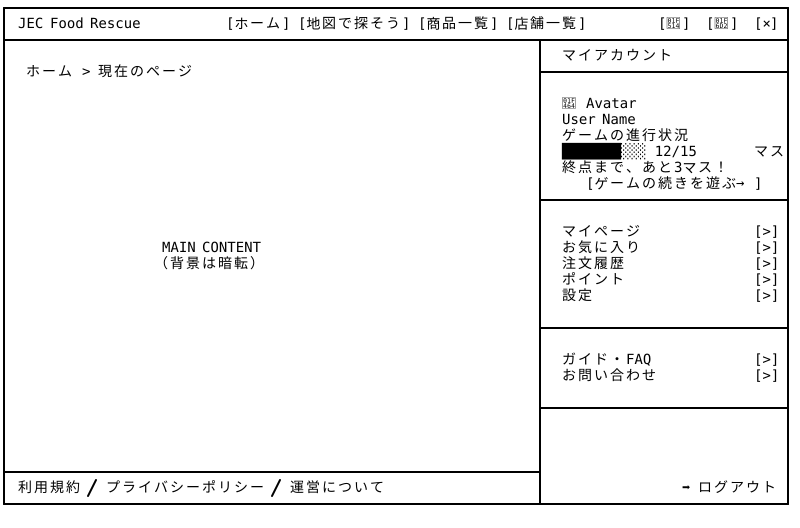
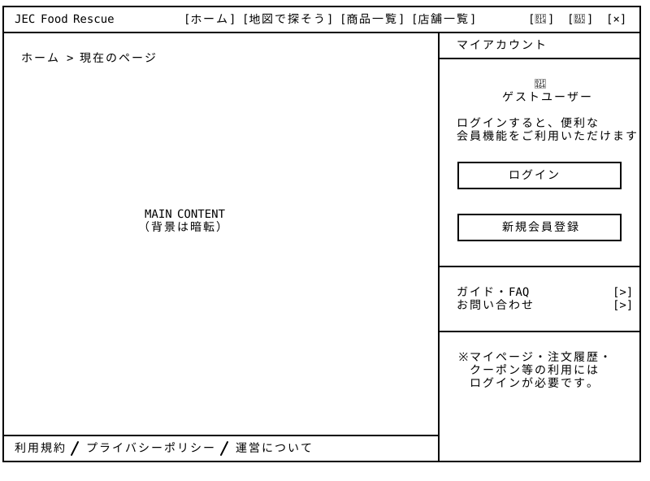

# Global Navigation + Account Drawer — Wireframe v4

## 画面プレビュー





## 共通レイアウトの使い方

Global Navigation + Account Drawerは、他のページとは独立した共通レイアウトとして設計する。

サービスロゴや全体ナビゲーション、アカウント管理機能は共通レイアウト側に配置するため、他のページ固有のレイアウトには含めない。

最終的には、**共通レイアウトと各ページのメインコンテンツを組み合わせて、一つの画面として表示する**。

## 0-1. ユーザーログイン済

```
┌─────────────────────────────────────────────────────────────────────────────────────────────────┐
│ JEC Food Rescue    　　　 [ホーム] [地図で探そう] [商品一覧] [店舗一覧]　　　　　　 [🔔] [🛒] [👤] │　⇒　展開状態になると[👤]は[×]に表示変更
├──────────────────────────────────────────────────────────────────┬──────────────────────────────┤
│                                                                  │  マイアカウント           　　 │
│ ホーム > 現在のページ                                              ├──────────────────────────────┤
│                                                                  │                              │
│                                                                  │  👤 Avatar                   │
│                                                                  │  User Name                   │
│                                                                  │  Lv.01                       │
│                                                                  │  ███████░░░░░  EXP           │
│                                                                  │                              │
│                                                                  ├──────────────────────────────┤
│                                                                  │                              │
│                                                                  │  マイページ               [>] │
│                   MAIN CONTENT                                   │  お気に入り               [>] │
│                  （背景は暗転）                                   │  注文履歴                 [>] │
│                                                                  │  クーポン                 [>] │
│                                                                  │  設定               　　  [>] │
│                                                                  │                              │
│                                                                  ├──────────────────────────────┤
│                                                                  │                              │
│                                                                  │  ガイド・FAQ         　　 [>] │
│                                                                  │  お問い合わせ             [>] │
│                                                                  │                              │
│                                                                  ├──────────────────────────────┤
│                                                                  │                              │
│                                                                  │  　　　　　　                 │
│                                                                  │                              │
├──────────────────────────────────────────────────────────────────┤                              │
│ 利用規約 / プライバシーポリシー / 運営について                  　   │                 ➡ ログアウト │
└──────────────────────────────────────────────────────────────────┴──────────────────────────────┘
```

### v3の変更点と設計意図

利用者の操作目的と画面特性に応じて、v2のナビゲーション構造を見直し、左側固定サイドバーを廃止して右側ドロワーメニューを採用した。

- 直感的な操作： v2では、ハンバーガーメニュー（☰）を主に個人アカウント管理のために使用していた。しかし、ハンバーガーアイコンは一般的にサイト全体のナビゲーションを示すことが多い。個人アカウント管理を目的と明示するため、v3では☰（ハンバーガーメニュー）を👤(ユーザーアイコン)に変更。

- 操作の一貫性： v2では、画面右上のアイコンから左側のサイドバーを操作する構成となっており、操作位置とメニュー表示位置が離れていた。v3では、右上のユーザーアイコンをクリックすると、右側からドロワーメニューが展開される構成に変更し、操作位置と表示方向を統一。

- 閲覧体験の向上： ユーザー向けのシステムでは、商品カードや店舗情報の閲覧が主要な利用目的となる。ドロワーメニューを必要に応じて開閉できるようにし、メインコンテンツの表示領域を確保。

- 視線誘導： ドロワーメニュー展開時に背景を半透明の暗色オーバーレイで減光し、メニュー操作への集中を促す。

参考：[Alpen Online](https://store.alpen-group.jp/)

※ 一方、システム管理者画面・店舗運営者画面では固定サイドバーを採用する。これらの画面では、在庫・注文・データ管理など複数の機能を頻繁に切り替えるため、ナビゲーションを常時表示し、操作効率を優先する。つまり、ユーザー向け画面では「閲覧体験」、管理・運営画面では「業務効率」を重視し、それぞれの利用目的に応じたUI設計を行う。

---

### v4の変更点と設計意図

基本的なアクセス方針はv3から変更しない。ただヘッダーの「商品を探す」を「地図で探そう」に名称変更しました。これは「商品一覧」および「店舗一覧」のv4更新に合わせ、マップ検索機能を独立した1つのページとして切り出していたためです。

## 0-2. ログインしてない

```
┌─────────────────────────────────────────────────────────────────────────────────────────────────┐
│ JEC Food Rescue    　　　 [ホーム] [地図で探そう] [商品一覧] [店舗一覧]　　　　　　 [🔔] [🛒] [👤] │　⇒　展開状態になると[👤]は[×]に表示変更
├──────────────────────────────────────────────────────────────────┬──────────────────────────────┤
│                                                                  │  マイアカウント   　　　　　　　│
│ ホーム > 現在のページ                                              ├──────────────────────────────┤
│                                                                  │                           　　│
│                                                                  │           👤                 │
│                                                                  │       ゲストユーザー           │
│                                                                  │                           　　│
│                                                                  │  ログインすると、便利な 　　　　│
│                                                                  │  会員機能をご利用いただけます　 │
│                                                                  │                              │
│                                                                  │  ┌────────────────────────┐  │
│                                                                  │  │       ログイン          │  │
│                                                                  │  └────────────────────────┘  │
│                                                                  │                              │
│                     MAIN CONTENT                                 │  ┌────────────────────────┐  │
│                    （背景は暗転）                                 │  │      新規会員登録      　│  │
│                                                                  │  └────────────────────────┘  │
│                                                                  │                              │
│                                                                  ├──────────────────────────────┤
│                                                                  │                              │
│                                                                  │  ガイド・FAQ              [>] │
│                                                                  │  お問い合わせ             [>] │
│                                                                  │                              │
│                                                                  ├──────────────────────────────┤
│                                                                  │                              │
│                                                                  │  ※ マイページ・注文履歴・     │
│                                                                  │    クーポン等の利用には        │
│                                                                  │    ログインが必要です。     　 │
│                                                                  │                              │
├──────────────────────────────────────────────────────────────────┤                              │
│ 利用規約 / プライバシーポリシー / 運営について                       │                              │
└──────────────────────────────────────────────────────────────────┴──────────────────────────────┘
```

### v3の変更点と設計意図

基本的なアクセス方針はv2から変更しない。

### v4の変更点と設計意図

基本的なアクセス方針はv3から変更しない。ただヘッダーの「商品を探す」を「地図で探そう」に名称変更しました。これは「商品一覧」および「店舗一覧」のv4更新に合わせ、マップ検索機能を独立した1つのページとして切り出していたためです。
