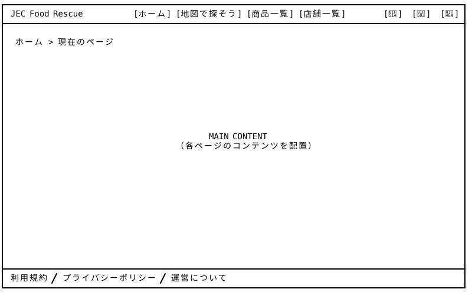
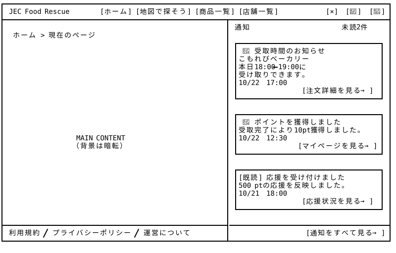
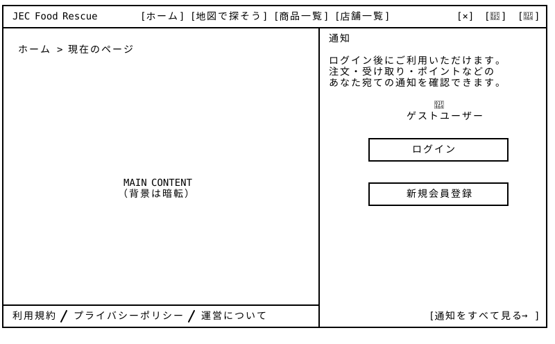
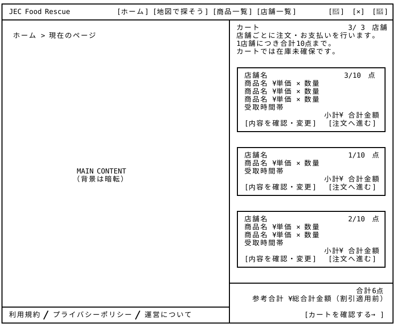
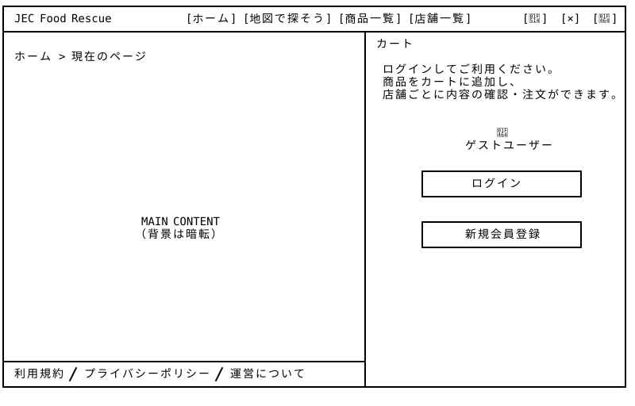

# Global Navigation + Drawer Menus — Wireframe v4

## 画面プレビュー












## 0. 共通レイアウトの使い方

Global Navigation + Drawer Menusは、他のページとは独立した共通レイアウトとして設計する。ヘッダー右上の通知・カート・アカウントは、それぞれ右側に開くドロワーとする。

サービスロゴや全体ナビゲーション、アカウント管理機能は共通レイアウト側に配置するため、他のページ固有のレイアウトには含めない。

最終的には、**共通レイアウトと各ページのメインコンテンツを組み合わせて、一つの画面として表示する**。

## 1. 共通レイアウト（ドロワー非表示） 

```
┌─────────────────────────────────────────────────────────────────────────────────────────────────┐
│ JEC Food Rescue    　　　 [ホーム] [地図で探そう] [商品一覧] [店舗一覧]　　　　　　 [🔔] [🛒] [👤] │
├─────────────────────────────────────────────────────────────────────────────────────────────────┤
│                                                                                                 │
│  ホーム > 現在のページ                                                                            │
│                                                                                                 │
│                                                                                                 │
│                                                                                                 │
│                                                                                                 │
│                                                                                                 │
│                                                                                                 │
│                                                                                                 │
│                                                                                                 │
│                                                                                                 │
│                                           MAIN CONTENT                                          │
│                                    （各ページのコンテンツを配置）                                  |
│                                                                                                 │
│                                                                                                 │
│                                                                                                 │
│                                                                                                 │
│                                                                                                 │
│                                                                                                 │
│                                                                                                 │
│                                                                                                 │
│                                                                                                 │
│                                                                                                 │
│                                                                                                 │
│                                                                                                 │
├─────────────────────────────────────────────────────────────────────────────────────────────────┤
│ 利用規約 / プライバシーポリシー / 運営について                  　                                  │
└─────────────────────────────────────────────────────────────────────────────────────────────────┘
```

## 2. アカウントドロワー（ログイン済み）

```
┌─────────────────────────────────────────────────────────────────────────────────────────────────┐
│ JEC Food Rescue    　　　 [ホーム] [地図で探そう] [商品一覧] [店舗一覧]　　　　　   [🔔] [🛒] [ × ] │
├──────────────────────────────────────────────────────────────────┬──────────────────────────────┤
│                                                                  │  マイアカウント                │
│  ホーム > 現在のページ                                             ├──────────────────────────────┤
│                                                                  │                              │
│                                                                  │  👤 Avatar                   │
│                                                                  │  User Name                    │
│                                                                  │  ゲームの進行状況              │
│                                                                  │  ███████████░░░░░  12 / 15マス│
│                                                                  │  終点まで、あと3マス！         │
│                                                                  │     [ゲームの続きを遊ぶ →]     │
│                                                                  ├──────────────────────────────┤
│                                                                  │                              │
│                                                                  │  マイページ               [>] │
│                   MAIN CONTENT                                   │  お気に入り               [>] │
│                  （背景は暗転）                                   │  注文履歴                 [>] │
│                                                                  │  ポイント                 [>] │
│                                                                  │  設定               　　  [>] │
│                                                                  │                              │
│                                                                  ├──────────────────────────────┤
│                                                                  │                              │
│                                                                  │  ガイド・FAQ         　　 [>] │
│                                                                  │  お問い合わせ             [>] │
│                                                                  │                              │
│                                                                  ├──────────────────────────────┤
│                                                                  │                              │
│                                                                  │  　　　　　　                 │
│                                                                  │                              │
├──────────────────────────────────────────────────────────────────┤                              │
│ 利用規約 / プライバシーポリシー / 運営について                  　   │                 ➡ ログアウト │
└──────────────────────────────────────────────────────────────────┴──────────────────────────────┘
```

### v4の変更点

アカウントドロワーの会員レベル・EXP制度を廃止し、ゲームマップの進行状況に変更しました。

そして検討の結果、クーポン機能も廃止することにしました。これにより一機能分の設計を省略でき、全体の作業量を抑えられます。

## 3. アカウントドロワー（未ログイン）

```
┌─────────────────────────────────────────────────────────────────────────────────────────────────┐
│ JEC Food Rescue    　　　 [ホーム] [地図で探そう] [商品一覧] [店舗一覧]　　　　　   [🔔] [🛒] [ × ] │
├──────────────────────────────────────────────────────────────────┬──────────────────────────────┤
│                                                                  │  マイアカウント   　　　　　　　│
│  ホーム > 現在のページ                                             ├──────────────────────────────┤
│                                                                  │                           　　│
│                                                                  │           👤                 │
│                                                                  │       ゲストユーザー           │
│                                                                  │                           　　│
│                                                                  │  ログインすると、便利な 　　　　│
│                                                                  │  会員機能をご利用いただけます　 │
│                                                                  │                              │
│                                                                  │  ┌────────────────────────┐  │
│                                                                  │  │       ログイン          │  │
│                                                                  │  └────────────────────────┘  │
│                                                                  │                              │
│                     MAIN CONTENT                                 │  ┌────────────────────────┐  │
│                    （背景は暗転）                                 │  │      新規会員登録      　│  │
│                                                                  │  └────────────────────────┘  │
│                                                                  │                              │
│                                                                  ├──────────────────────────────┤
│                                                                  │                              │
│                                                                  │  ガイド・FAQ              [>] │
│                                                                  │  お問い合わせ             [>] │
│                                                                  │                              │
│                                                                  ├──────────────────────────────┤
│                                                                  │                              │
│                                                                  │  ※ マイページ・注文履歴・     │
│                                                                  │    ポイント等の利用には        │
│                                                                  │    ログインが必要です。     　 │
│                                                                  │                              │
├──────────────────────────────────────────────────────────────────┤                              │
│ 利用規約 / プライバシーポリシー / 運営について                       │                              │
└──────────────────────────────────────────────────────────────────┴──────────────────────────────┘
```

### v4の変更点

検討の結果、クーポン機能を廃止することにしました。これにより一機能分の設計を省略でき、全体の作業量を抑えられます。

## 4. 通知ドロワー（ログイン済み）

ヘッダーの[🔔]を選択すると右側に展開し、通知の日時・未読状態・内容と関連画面への導線を表示する。開いている間は[🔔]を[×]に変更する。

```
┌─────────────────────────────────────────────────────────────────────────────────────────────────┐
│ JEC Food Rescue        [ホーム] [地図で探そう] [商品一覧] [店舗一覧]              [ × ] [🛒] [👤] │
├────────────────────────────────────────────────────────┬────────────────────────────────────────┤
│                                                        │ 通知                       未読 2件     │
│  ホーム > 現在のページ                                   │                                        │
│                                                        │ ┌────────────────────────────────────┐ │
│                                                        │ │● 受取時間のお知らせ                  │ │
│                                                        │ │こもれびベーカリー                    │ │
│                                                        │ │本日18:00–19:00に                    │ │
│                                                        │ │受け取りできます。                    │ │
│                                                        │ │10/22 17:00                         │ │
│                                                        │ │                 [注文詳細を見る →]  │ │
│                                                        │ └────────────────────────────────────┘ │
│                                                        │                                        │
│                                                        │ ┌────────────────────────────────────┐ │
│                                                        │ │● ポイントを獲得しました              │ │
│                                                        │ │受取完了により10pt獲得しました。      │ │
│                  MAIN CONTENT                          │ │10/22 12:30                         │ │
│                 （背景は暗転）                          │ │                [マイページを見る →]  │ │
│                                                        │ └────────────────────────────────────┘ │
│                                                        │                                        │
│                                                        │ ┌────────────────────────────────────┐ │
│                                                        │ │[既読] 応援を受け付けました           │ │
│                                                        │ │500 ptの応援を反映しました。          │ │
│                                                        │ │10/21 18:00                         │ │
│                                                        │ │                 [応援状況を見る →]  │ │
│                                                        │ └────────────────────────────────────┘ │
│                                                        │                                        │
├────────────────────────────────────────────────────────┤────────────────────────────────────────┤
│ 利用規約 / プライバシーポリシー / 運営について             │                    [通知をすべて見る →] │
└────────────────────────────────────────────────────────┴────────────────────────────────────────┘
```

通知一覧は内部スクロールとし、下部の「通知をすべて見る」は固定表示する。表示例は最近の3件とし、過去の通知は[通知一覧ページ](../../16_notifications/v4/README.md)で確認する。

## 5. 通知ドロワー（未ログイン）

```
┌─────────────────────────────────────────────────────────────────────────────────────────────────┐
│ JEC Food Rescue        [ホーム] [地図で探そう] [商品一覧] [店舗一覧]              [ × ] [🛒] [👤] │
├────────────────────────────────────────────────────────┬────────────────────────────────────────┤
│                                                        │ 通知                                   │
│  ホーム > 現在のページ                                   │                                        │
│                                                        │ ログイン後にご利用いただけます。          │
│                                                        │ 注文・受け取り・ポイントなどの            │
│                                                        │ あなた宛ての通知を確認できます。          │
│                                                        │                                        │
│                                                        │                    👤                  │
│                                                        │               ゲストユーザー            │
│                                                        │                                        │
│                                                        │        ┌────────────────────────┐      │
│                                                        │        │        ログイン         │      │
│                                                        │        └────────────────────────┘      │
│                                                        │                                        │
│                     MAIN CONTENT                       │        ┌────────────────────────┐      │
│                    （背景は暗転）                       │        │       新規会員登録     　│      │
│                                                        │        └────────────────────────┘      │
│                                                        │                                        │
│                                                        │                                        │
│                                                        │                                        │
│                                                        │                                        │
│                                                        │                                        │
│                                                        │                                        │
│                                                        │                                        │
│                                                        │                                        │
├────────────────────────────────────────────────────────┤                                        │
│ 利用規約 / プライバシーポリシー / 運営について             │                                        │
└────────────────────────────────────────────────────────┴────────────────────────────────────────┘
```

未ログイン時は個人宛ての通知内容・未読件数を表示せず、ログインと新規会員登録への導線を表示する。

## 6. カートドロワー（ログイン済み）

ヘッダーの[🛒]を選択すると右側に展開し、開いている間は[🛒]を[×]に変更する。[カート全体ページ](../../10_cart_checkout/v3/README.md)と同じ情報・操作を保持し、カードの表示幅と余白、テキストの改行位置を調整してパネル内に配置する。

```
┌─────────────────────────────────────────────────────────────────────────────────────────────────┐
│ JEC Food Rescue            [ホーム] [地図で探そう] [商品一覧] [店舗一覧]           [🔔] [ × ] [👤] │
├────────────────────────────────────────────────────────┬────────────────────────────────────────┤
│                                                        │ カート                       3 / 3店舗  │
│  ホーム > 現在のページ                                   │ 店舗ごとに注文・お支払いを行います。      │
│                                                        │ 1店舗につき合計10点まで。                │
│                                                        │ カートでは在庫未確保です。               │
│                                                        │                                        │
│                                                        │ ┌────────────────────────────────────┐ │
│                                                        │ │ 店舗名                    3 / 10点  │ │
│                                                        │ │ 商品名 ¥単価 × 数量                 │ │
│                                                        │ │ 商品名 ¥単価 × 数量                 │ │
│                                                        │ │ 商品名 ¥単価 × 数量                 │ │
│                                                        │ │ 受取時間帯                          │ │
│                                                        │ │                      小計 ¥合計金額 │ │
│                                                        │ │　[内容を確認・変更] 　[注文へ進む]    │ │
│                                                        │ └────────────────────────────────────┘ │
│                                                        │                                        │
│                                                        │ ┌────────────────────────────────────┐ │
│                                                        │ │ 店舗名                    1 / 10点  │ │
│                                                        │ │ 商品名 ¥単価 × 数量                 │ │
│                  MAIN CONTENT                          │ │ 受取時間帯                          │ │
│                 （背景は暗転）                          │ │                      小計 ¥合計金額 │ │
│                                                        │ │　[内容を確認・変更] 　[注文へ進む]    │ │
│                                                        │ └────────────────────────────────────┘ │
│                                                        │                                        │
│                                                        │ ┌────────────────────────────────────┐ │
│                                                        │ │ 店舗名                    2 / 10点  │ │
│                                                        │ │ 商品名 ¥単価 × 数量                 │ │
│                                                        │ │ 商品名 ¥単価 × 数量                 │ │
│                                                        │ │ 受取時間帯                          │ │
│                                                        │ │                      小計 ¥合計金額 │ │
│                                                        │ │　[内容を確認・変更] 　[注文へ進む]    │ │
│                                                        │ └────────────────────────────────────┘ │
│                                                        │                                        │
│                                                        ├────────────────────────────────────────┤
│                                                        │                                合計6点  │
│                                                        │        参考合計 ¥総合計金額（割引適用前） │
├────────────────────────────────────────────────────────┤────────────────────────────────────────┤
│ 利用規約 / プライバシーポリシー / 運営について             │                   [カートを確認する →]  │
└────────────────────────────────────────────────────────┴────────────────────────────────────────┘
```

店舗カードの一覧は内部スクロールとする。合計点数・参考合計・「カートを確認する」は下部の固定領域に配置する。

- 各カードには、店舗名、店舗ごとの点数、商品名・単価・数量、受取時間帯、小計、「内容を確認・変更」「注文へ進む」を省略せず表示する。
- 「内容を確認・変更」は、店舗ごとのカート詳細ページへ進む。「注文へ進む」は、対象店舗の注文確認ページへ進む。どちらも遷移時にドロワーを閉じる。
- 「カートを確認する」は、カート全体ページへ進む。
- カートの内容・合計値は、ドロワーとカートページで共通とする。カート詳細で変更した内容は、再度ドロワーを開いた際にも反映する。

## 7. カートドロワー（未ログイン）

```
┌─────────────────────────────────────────────────────────────────────────────────────────────────┐
│ JEC Food Rescue            [ホーム] [地図で探そう] [商品一覧] [店舗一覧]          [🔔] [ × ] [👤] │
├────────────────────────────────────────────────────────┬────────────────────────────────────────┤
│                                                        │ カート                                  │
│ ホーム > 現在のページ                                    │                                        │
│                                                        │  ログインしてご利用ください。             │
│                                                        │  商品をカートに追加し、                  │
│                                                        │  店舗ごとに内容の確認・注文ができます。   │
│                                                        │                                        │
│                                                        │                                        │
│                                                        │                    👤                  │
│                                                        │               ゲストユーザー            │
│                                                        │                                        │
│                                                        │        ┌────────────────────────┐      │
│                                                        │        │        ログイン         │      │
│                                                        │        └────────────────────────┘      │
│                                                        │                                        │
│                     MAIN CONTENT                       │        ┌────────────────────────┐      │
│                    （背景は暗転）                       │        │       新規会員登録     　│      │
│                                                        │        └────────────────────────┘      │
│                                                        │                                        │
│                                                        │                                        │
│                                                        │                                        │
│                                                        │                                        │
│                                                        │                                        │
│                                                        │                                        │
│                                                        │                                        │
│                                                        │                                        │
├────────────────────────────────────────────────────────┤                                        │
│ 利用規約 / プライバシーポリシー / 運営について             │                                        │
└────────────────────────────────────────────────────────┴────────────────────────────────────────┘
```

未ログイン時はログイン後に利用できる機能を説明し、ログインと新規会員登録への導線を表示する。

## 8. ドロワー共通の表示・操作仕様

| 項目 | 表示・操作仕様 |
|---|---|
| 開閉と切替 | 通知・カート・アカウントは同時に1つだけ開く。他のアイコンを選択した場合は、開いている内容を切り替える。 |
| ヘッダーのアイコン | 開いている入口のアイコンだけを[×]に変更する。閉じる・切り替える際は元のアイコンへ戻す。[×]の操作名は「通知を閉じる」「カートを閉じる」「アカウントを閉じる」とする。 |
| 閉じる操作 | ヘッダーの[×]、背景の暗色オーバーレイ、Escキーで閉じる。閉じた後は元のページのスクロール位置を維持する。 |
| スクロール | 展開中は背景ページをスクロールさせず、長い一覧はドロワー内部でスクロールする。通知・カートのログイン済みパネルでは、下部の完全版ページへの入口を固定表示する。 |
| 完全版ページへの導線 | 通知は[通知一覧](../../16_notifications/v4/README.md)、カートは[カート全体](../../10_cart_checkout/v3/README.md)、アカウントは[マイページ](../../06_mypage/v4/README.md)への入口を残す。遷移時はドロワーを閉じる。 |
| 未ログイン時 | 通知・カートは利用説明と[ログイン](../../12_login/v4/README.md)・[新規会員登録](../../13_signup/v3/README.md)への導線を表示する。ログイン完了後は元のページへ戻り、開こうとしていたドロワーを表示する。 |
| 通知の既読処理 | ドロワーや通知ページを開いただけでは既読にしない。個別の通知カードまたは関連画面へのリンクを選択した時点で、その通知だけを既読にする。未読状態・件数はドロワーと通知ページで同期する。 |

### 空状態・取得失敗時の表示

| 対象 | 状態 | 表示・操作 |
|---|---|---|
| 通知 | 通知がない | 一覧領域に「通知はありません」と表示する。「通知をすべて見る」は固定領域に残す。 |
| カート | 商品がない | 一覧領域に「カートに商品がありません」と表示し、中央に「商品を探す」を案内する。合計0点・参考合計¥0と「カートを確認する」を固定領域に表示する。 |
| 通知・カート | 取得失敗 | 一覧領域に「読み込めませんでした」と「再読み込み」を表示する。空状態や合計0件として扱わず、取得できていない件数・金額は「—」とする。 |

## 9. v4の変更点と設計意図

- 共通レイアウトの基本状態を明示：
  従来のログイン済み・未ログインのドロワー展開図に加え、**ドロワーを表示しない基本状態の図を追加した**。ヘッダーとフッターの構成、および各ページのメインコンテンツを配置する領域を明確にし、共通レイアウトとページ固有の内容を組み合わせた際の画面構成を把握しやすくする。

- ドロワーの表示状態を整理：
  「ドロワー非表示」に加え、アカウント・通知・カートそれぞれのログイン済み・未ログインを示し、合計7つの表示状態に整理した。通常の閲覧状態と各ドロワーの違いを明確にする。

- 地図検索への導線を明確化：
  ヘッダーの「商品を探す」を「地図で探そう」に変更した。「商品一覧」および「店舗一覧」のv4更新に合わせ、マップ検索機能を独立したページとして整理したためである。

- 3つの入口の操作を統一：
  通知・カート・アカウントを、ヘッダー右上の各アイコンから右側に開くドロワーとして整理した。閲覧中のページを離れずに必要な情報を確認し、閉じた後は元の閲覧位置で操作を続けられるようにする。

- 通知・カートのログイン状態別レイアウトを追加：
  それぞれログイン済み・未ログインの2状態を設計した。ログイン済みでは内容を表示し、未ログインでは利用説明とログインへの導線を表示する。

- カートの情報と操作を維持：
  店舗ごとのカードはカート全体ページと同じ項目・操作を保持し、表示幅に合わせてカードと改行位置を調整した。店舗ごとの確認・注文と、カート全体ページでの確認の両方に対応する。

- 一覧閲覧と完全版ページへの導線を両立：
  通知・カートは一覧部分だけを内部スクロールとし、完全版ページへの入口を下部に固定した。概要確認から詳細な確認へ進む導線を見失わない構成とする。

- 通知の既読状態を統一：
  パネルを開いただけでは既読にせず、個別の通知を選択した時点で既読にする。通知ドロワーと通知一覧ページで状態を共有し、未確認の情報を把握しやすくする。
