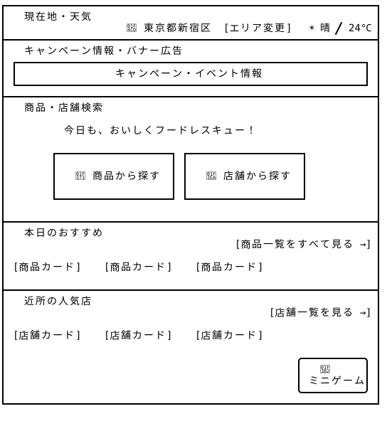
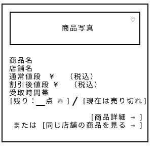
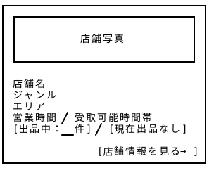

# ホームページ — Wireframe v3

## 画面プレビュー







## 1-1. ホームページ全体

```
┌─────────────────────────────────────────────────────────────────┐
│ ① 現在地・天気                                        　　　　    │
│  　                    📍東京都新宿区  [エリア変更]   ☀ 晴/24℃  │
├─────────────────────────────────────────────────────────────────┤
│ ② キャンペーン情報・バナー広告                                  　 │
│ ┌─────────────────────────────────────────────────────────────┐ │
│ │                 キャンペーン・イベント情報         　　　　　  │ │
│ └─────────────────────────────────────────────────────────────┘ │
├─────────────────────────────────────────────────────────────────┤
│ ③ 商品・店舗検索                                　　　　　        │
│                                                           　　  │
│          今日も、おいしくフードレスキュー！            　　　      │
│                              　　                               │
│ 　　   ┌────────────────────┐ ┌────────────────────┐            │
│  　　  │                    │ │                    │            │
│  　　  │   🍱 商品から探す　 │ │   🏪 店舗から探す　 │            │
│   　　 │                    │ │                    │            │
│   　　 └────────────────────┘ └────────────────────┘            │
│                                                          　　   │
├─────────────────────────────────────────────────────────────────┤
│ ④ 本日のおすすめ　　　                                            │
│                                          [商品一覧をすべて見る →] │
│ [商品カード]    [商品カード]    [商品カード]    　                 │
├─────────────────────────────────────────────────────────────────┤
│ ⑤ 近所の人気店             　　　                                 │
│ 　　　　　　　　                       　　     [店舗一覧を見る →] │
│ [店舗カード]    [店舗カード]    [店舗カード]                       │
│                                                                 │
│                                                   ╭───────────╮ │
│                                                   │ ⑥ 🎲      │ │
│                                                   │ ミニゲーム │ │
│                                                   ╰───────────╯ │
└─────────────────────────────────────────────────────────────────┘
```

v3では、固定Sidebarを廃止するとともに、**ホーム画面の役割を「情報の発見と各ページへの入口」と位置づけ、商品と店舗への詳細な検索・絞り込み・並び替え等々機能は各一覧ページに集約することを再検討した。**

まず、「店舗一覧」への直接アクセスを追加し、商品だけでなく店舗を起点として探せるようにした。

そして、ホーム画面では、ユーザーが「近くで購入可能な商品」「商品・店舗の両方から探す手段」「本日のおすすめ・キャンペーン情報」を直感的に把握できることを重視する。当初は、ホーム画面内に「商品検索・商品一覧」「店舗検索・店舗一覧」を設け、検索・絞り込み・並び替え機能を集約する構成を検討していた。しかし、各一覧ページとの機能重複や画面の複雑化を考慮し、この案を廃止した（　＾ω＾）・・・

これにより、ホーム画面の導線をさらに簡素化し、ユーザーが目的に応じて各ページへ移動しやすい構成をできるようになりました。

| エリア | 機能・設計方針 |
|---|---|
| ① 現在地・天気 | 現在地・設定エリア・天気情報を表示し、近隣の商品や店舗を探す際の基準とする。 |
| ② キャンペーン情報・バナー広告 | 季節限定キャンペーン、イベント情報、広告などを表示する。 |
| ③ 商品・店舗検索 | 「商品から探す」「店舗から探す」の2つの入口を設置。それぞれ商品一覧・店舗一覧へ遷移し、詳細な検索・絞り込みを行えるようにする。 |
| ④ 本日のおすすめ | エリアや利用履歴などをもとに、おすすめ商品を一部表示。商品詳細・商品一覧への導線を設ける。 |
| ⑤ 近所の人気店 | 近隣のおすすめ店舗を紹介し、店舗情報・店舗一覧への導線を設ける。 |
| ⑥ ミニゲーム | 画面右下にFloating Action Buttonとして固定配置。1日2回プレイ可能とし、継続利用を促す。 |

## 1-2. 商品カード

```
┌───────────────────────────────────┐ 
│ ┌───────────────────────────────┐ │ 
│ │              　             ♡ │ │ 
│ │            商品写真    　      │ │ 
│ │                               │ │ 
│ └───────────────────────────────┘ │
│                                   │
│ 商品名                           　│ 
│ 店舗名                           　│ 
│ 通常値段 ¥XXX（税込）             　│ 
│ 割引後値段 ¥XXX（税込）             │ 
│ 受取時間帯　　　　                  │ 
│ [残り：__点 🔥] / [現在は売り切れ]  │ 
│                                   │ 
│                      [商品詳細 → ] │
│     または [同じ店舗の商品を見る → ] │ 
│                                   │ 
└───────────────────────────────────┘ 
```

## 1-3. 店舗カード

```
┌───────────────────────────────────┐ 
│ ┌───────────────────────────────┐ │ 
│ │                               │ │ 
│ │           店舗写真          　 │ │ 
│ │                               │ │ 
│ └───────────────────────────────┘ │ 
│                                   │
│ 店舗名                             │ 
│ ジャンル                           │ 
│ エリア                             │ 
│ 営業時間 / 受取可能時間帯           │ 
│ [出品中：__件] / [現在出品なし]     │ 
│                                   │ 
│                 [店舗情報を見る →] │ 
└───────────────────────────────────┘ 
```
