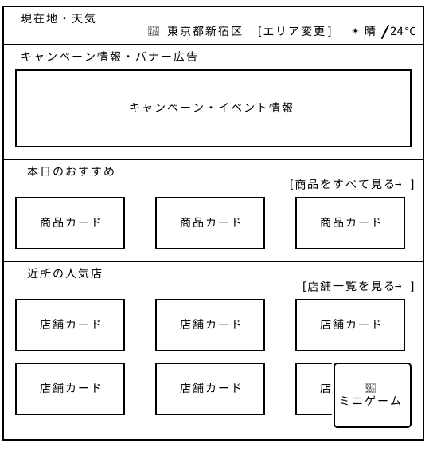
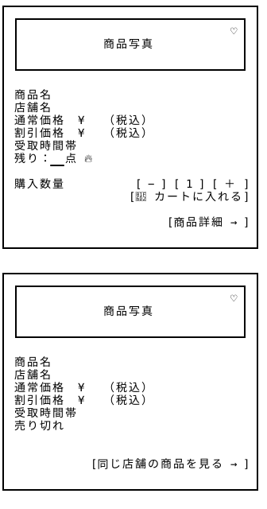
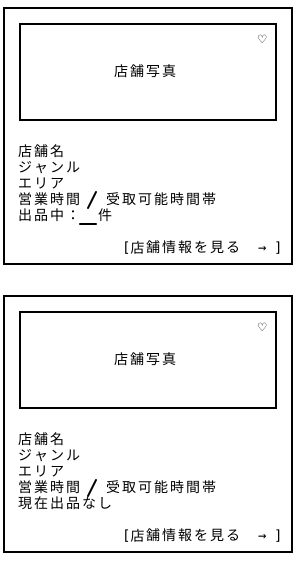

# ホームページ — Wireframe v4

## 画面プレビュー







## 1. ホームページ全体

```
┌─────────────────────────────────────────────────────────────────┐
│   現在地・天気                                        　　　    　│
│  　                  📍 東京都新宿区  [エリア変更]   ☀ 晴/ 24℃  │
├─────────────────────────────────────────────────────────────────┤
│  キャンペーン情報・バナー広告                                      │
│ ┌─────────────────────────────────────────────────────────────┐ │
│ │                                                             │ │
│ │                                                             │ │
│ │                                                             │ │
│ │                                                             │ │
│ │  [‹]           キャンペーン・イベント画像             　 [›]  │ │
│ │                                                             │ │
│ │                                                             │ │
│ │                                                             │ │
│ │                          ● ○ ○                              │ │
│ └─────────────────────────────────────────────────────────────┘ │
├─────────────────────────────────────────────────────────────────┤
│                                                                 │
│  本日のおすすめ　　　                                          　 │
│                                        　  [商品をすべて見る  → ] │
│ ┌────────────────┐    ┌────────────────┐    ┌────────────────┐  │
│ │                │    │                │    │                │  │
│[‹]  商品カード    │    │   商品カード    │    │   商品カード   [›] │
│ │                │    │                │    │                │  │
│ └────────────────┘    └────────────────┘    └────────────────┘  │
│                                                                 │
├─────────────────────────────────────────────────────────────────┤
│  近所の人気店             　　　                                  │
│ 　　　　　　　　                   　　       [店舗一覧を見る  → ] │
│ ┌────────────────┐    ┌────────────────┐    ┌────────────────┐  │
│ │                │    │                │    │                │  │
│ │   店舗カード    │    │   店舗カード    │    │   店舗カード    │  │
│ │                │    │                │    │                │  │
│ └────────────────┘    └────────────────┘    └────────────────┘  │
│                                                                 │
│ ┌────────────────┐    ┌────────────────┐    ┌─────╭───────────╮ │
│ │                │    │                │    │     │           │ │
│ │   店舗カード    │    │   店舗カード    │    │   店│    🎲     │ │
│ │                │    │                │    │     │ ミニゲーム │ │ 
│ └────────────────┘    └────────────────┘    └─────│           │ │
│                           [もっと見る ▼]           ╰───────────╯ │
└─────────────────────────────────────────────────────────────────┘
```

### v4の変更点と設計意図

- v4では、共通レイアウトのヘッダー部にある「商品一覧」「店舗一覧」と遷移先が重複していた「商品から探す」「店舗から探す」の2つの入口を削除した。
    これにより、**共通レイアウトのヘッダー部を通じて、各検索ページへの直接アクセス、ホームページはおすすめ商品や店舗の発見を集中**という役割を明確に分けた。一方、「商品をすべて見る」「店舗一覧を見る」は、紹介された商品や店舗に興味を持ったユーザーが、さらに詳しく探せるようにするための導線として残した。

- キャンペーン情報・バナー広告エリアをカルーセル形式に変更し、矢印ボタンで画像を切り替えられるようにした。限られた表示領域で複数のキャンペーン・イベント情報を紹介できるようにし、下部のインジケーターで画像の枚数と現在の表示位置を示す。
  
- 「本日のおすすめ」に商品カードを左右にスライドして閲覧できるUIを追加し、限られた表示領域でより多くのおすすめ商品を紹介できるようにした。

- 「近所の人気店」に「もっと表示する」ボタンを追加し、同じページ内で店舗カードを段階的に追加表示することで、初期表示をコンパクトに保ちながら、関心に応じて近隣の店舗を探せるようにした。

| エリア | 機能・設計方針 |
|---|---|
| ① 現在地・天気 | 現在地・設定エリア・天気情報を表示し、近隣の商品や店舗を探す際の基準とする。 |
| ② キャンペーン情報・バナー広告 | 季節限定キャンペーン、イベント情報、広告などを表示する。矢印ボタンで画像を切替できます。 |
| ③ 本日のおすすめ | エリアや利用履歴などをもとに、おすすめ商品を一部表示。商品一覧への導線を設ける。 |
| ④ 近所の人気店 | 近隣のおすすめ店舗を紹介し、店舗一覧への導線を設ける。 |
| ⑤ ミニゲーム | 画面右下にFloating Action Buttonとして固定配置。1日2回プレイ可能とし、継続利用を促す。 |


## 2. 商品カード

```
┌───────────────────────────────────────┐
│ ┌───────────────────────────────────┐ │
│ │                                 ♡ │ │
│ │             商品写真               │ │
│ │                                   │ │
│ └───────────────────────────────────┘ │
│                                       │
│ 商品名                                │
│ 店舗名                                │
│ 通常価格 ¥XXX（税込）                  │
│ 割引価格 ¥XXX（税込）                  │
│ 受取時間帯                            │
│ 残り：__点 🔥                        │
│                                      │
│ 購入数量           [ − ] [ 1 ] [ ＋ ] │
│                   [🛒 カートに入れる] │
│                                      │
│                          [商品詳細 →] │
│                                       │
└───────────────────────────────────────┘ 

┌───────────────────────────────────────┐
│ ┌───────────────────────────────────┐ │
│ │                                 ♡ │ │
│ │             商品写真               │ │
│ │                                   │ │
│ └───────────────────────────────────┘ │
│                                       │
│ 商品名                                │
│ 店舗名                                │
│ 通常価格 ¥XXX（税込）                  │
│ 割引価格 ¥XXX（税込）                  │
│ 受取時間帯                            │
│ 売り切れ                              │
│                                      │
│                                      │
│               [同じ店舗の商品を見る →] │
│                                       │
└───────────────────────────────────────┘ 
```

### v4の変更点と設計意図

商品カードを在庫状況に応じて「販売中」と「売り切れ」の2つの表示パターンに分けた。

販売中の商品には、購入数量を調整できるステッパー（−／＋）と「カートに入れる」ボタンを追加した。これにより、商品詳細ページを経由せず、一覧画面から希望数量を指定してカートに追加できるようにした。

一方、売り切れの商品では数量選択とカートへの追加機能を非表示にし、代わりに「同じ店舗の商品を見る」ボタンを設置した。これにより、購入できない商品に対する誤操作を防ぎながら、同じ店舗で販売中のほかの商品へ誘導する。

なお、「次回出品通知」機能についても検討したが、やはり「お気に入り店舗」または通知機能に設置された方がいいと思います。今回は採用を見送った。


## 3. 店舗カード

```
┌───────────────────────────────────┐ 
│ ┌───────────────────────────────┐ │ 
│ │                             ♡ │ │ 
│ │           店舗写真          　 │ │ 
│ │                               │ │ 
│ └───────────────────────────────┘ │ 
│                                   │
│ 店舗名                             │ 
│ ジャンル                           │ 
│ エリア                             │ 
│ 現在地からの距離                    │
│ 営業時間 / 受取可能時間帯           │ 
│ 出品中：__件                       │ 
│                                   │ 
│                [店舗情報を見る → ] │ 
└───────────────────────────────────┘ 

┌───────────────────────────────────┐ 
│ ┌───────────────────────────────┐ │ 
│ │                             ♡ │ │ 
│ │           店舗写真          　 │ │ 
│ │                               │ │ 
│ └───────────────────────────────┘ │ 
│                                   │
│ 店舗名                             │ 
│ ジャンル                           │ 
│ エリア                             │ 
│ 現在地からの距離                    │
│ 営業時間 / 受取可能時間帯           │ 
│ 現在出品なし                       │ 
│                                   │ 
│                 [店舗情報を見る →] │ 
└───────────────────────────────────┘
```

### v4の変更点と設計意図

店舗カードを出品状況に応じて「出品中」と「現在出品なし」の2つの表示パターンに分けた。
見落とし分の「お気に入り」ボタンを追加済。