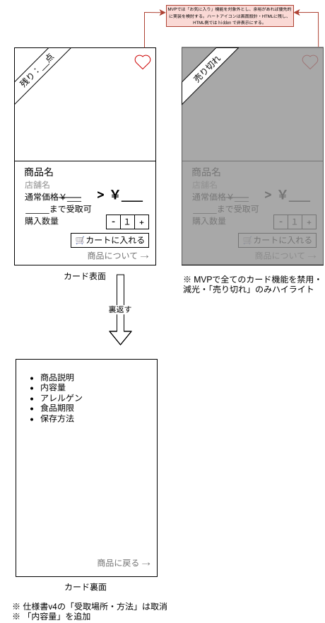

# コンポーネント・商品カード - v6

最後更新：2026-11-13

## v5からの変更

- カード裏面に「内容量」を追加（`goods_master.unit_weight`、単位：g）
- 「受取時間帯」を「\_\_\_\_まで受取可」に変更。締め切りは、出品の`sale_end`と店舗の閉店時間の早いほうとする
- お気に入りはMVP対象外。ハートアイコンは設計・HTMLに残し、HTMLの`hidden`属性で非表示にする。余裕があれば優先的に実装を検討する
- 裏面の表記を「アレルゲン」に統一（`goods_master.allergen`）

### 関連

1. [受取時間についての議論](https://github.com/bbudootan/food-loss-graduation-project/issues/6#issuecomment-6852560583)
2. [業務ルール（D-05・D-16）](https://github.com/bbudootan/food-loss-graduation-project/blob/main/DB/DECISIONS.md)
