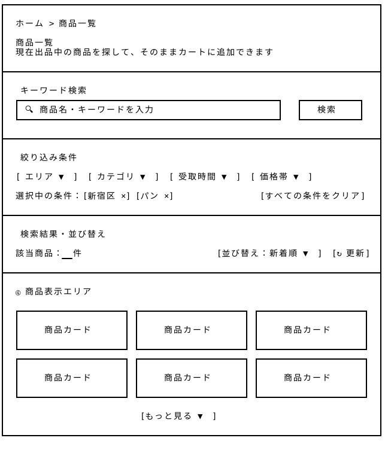

# 商品一覧 — Wireframe v4

## 画面プレビュー



## 商品一覧ページ

| エリア | 機能・設計方針 |
|---|---|
| ① キーワード検索 | 商品名やキーワードによる検索機能を提供 |
| ② 絞り込み条件 | エリア・カテゴリ・受取時間・価格帯を指定し、複数条件による検索を可能にする。選択中の条件は個別に解除できる |
| ③ 検索結果・並び替え | 該当件数を表示し、新着順・価格順・受取時間順などで並び替える |
| ④ 商品表示エリア | 商品カードのグリッド形式で商品を表示。**各カードには数量選択とカートに追加できる機能が備わっています** |

```
┌──────────────────────────────────────────────────────────────────────────────┐
│                                                                              │
│  ホーム > 商品一覧                                                            │
│                                                                              │
│  商品一覧                                                                     │
│  現在出品中の商品を探して、そのままカートに追加できます                           │
│                                                                              │
├──────────────────────────────────────────────────────────────────────────────┤
│                                                                              │
│  ① キーワード検索                                                             │
│  ┌──────────────────────────────────────────────────────┐   ┌────────────┐   │
│  │ 🔍 商品名・キーワードを入力                            │   │   検索     │   │
│  └──────────────────────────────────────────────────────┘   └────────────┘   │
│                                                                              │
├──────────────────────────────────────────────────────────────────────────────┤
│                                                                              │
│  ② 絞り込み条件                                                               │
│                                                                              │
│  [ エリア ▼ ]  [ カテゴリ ▼ ]  [ 受取時間 ▼ ]  [ 価格帯 ▼ ]                 　  │
│                                                                              │
│  選択中の条件：[新宿区 ×] [パン ×]                      [すべての条件をクリア]   │
│                                                                              │
├──────────────────────────────────────────────────────────────────────────────┤
│                                                                              │
│  ③ 検索結果・並び替え                                                          │
│                                                                              │
│  該当商品：__件                           　    [並び替え：新着順 ▼]  [↻ 更新]  │
│                                                                              │
├──────────────────────────────────────────────────────────────────────────────┤
│                                                                              │
│  ④ 商品表示エリア                                                             │
│                                                                              │
│  ┌──────────────────────┐ ┌──────────────────────┐ ┌──────────────────────┐  │
│  │                      │ │                      │ │                      │  │
│  │     商品カード        │ │     商品カード        │ │     商品カード        │  │
│  │                      │ │                      │ │                      │  │
│  └──────────────────────┘ └──────────────────────┘ └──────────────────────┘  │
│  ┌──────────────────────┐ ┌──────────────────────┐ ┌──────────────────────┐  │
│  │                      │ │                      │ │                      │  │
│  │     商品カード        │ │     商品カード        │ │     商品カード        │  │
│  │                      │ │                      │ │                      │  │
│  └──────────────────────┘ └──────────────────────┘ └──────────────────────┘  │
│                                                                              │
│                            [もっと見る ▼]                                     │
│                                                                              │
└──────────────────────────────────────────────────────────────────────────────┘
```

### v4の変更点と設計意図

- v3では商品一覧ページ内に「一覧表示／地図表示」の切り替えを設けていたが、v4では役割を整理し、商品一覧ページは「商品を探す・比較する・カートに追加する」ことに特化した。
  
- 地図を使った探索は新設の「地図で探そう」ページへ分離し、ページ構造を簡潔にした。
  
- また、商品カードv4に数量調整ボタンと「カートに追加」ボタンを追加し、一覧ページから直接購入行動へ進めるよう改善した。