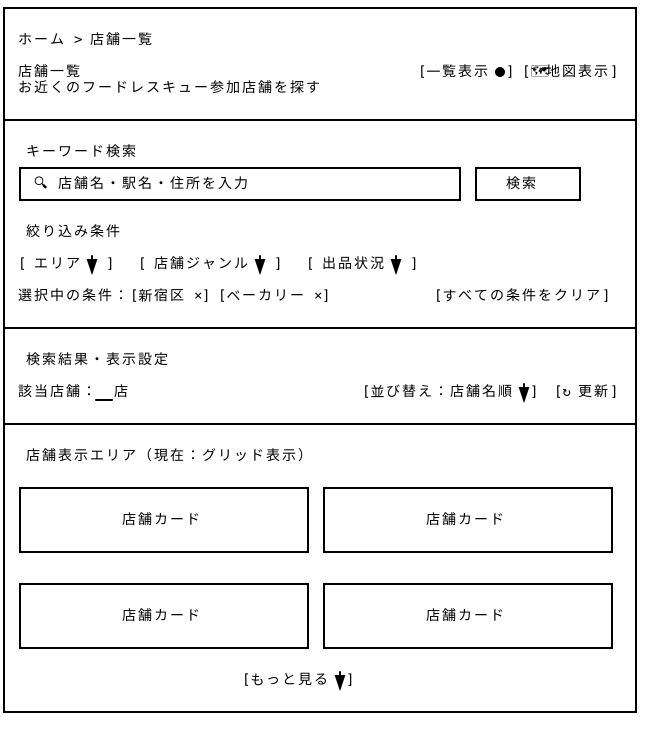

# 店舗一覧 — Wireframe v4

## 画面プレビュー



## 店舗一覧ページ

| エリア | 機能・設計方針 |
|---|---|
| ① キーワード検索 | 店舗名・駅名・住所などのキーワードによる検索機能を提供する。 |
| ② 絞り込み条件 | エリア・店舗ジャンル・出品状況を指定し、複数条件による検索を可能にする。選択中の条件は個別に解除できる。 |
| ③ 検索結果・並び替え | 該当店舗数を表示し、店舗名順・出品数順などで並び替える。 |
| ④ 店舗表示エリア | 店舗カードのグリッド形式で公開中の全店舗を表示。店舗写真・店舗名・ジャンル・所在地・出品状況を確認でき、店舗情報ページへ遷移する。 |

```
┌──────────────────────────────────────────────────────────────────────────────┐
│                                                                              │
│  ホーム > 店舗一覧                                                            │
│                                                                              │
│  店舗一覧                                                                     │
│  加盟したの全店舗を探して、店舗情報や出品状況を確認できます                       │
│                                                                              │
├──────────────────────────────────────────────────────────────────────────────┤
│                                                                              │
│  ① キーワード検索                                                             │
│  ┌──────────────────────────────────────────────────────┐   ┌────────────┐   │
│  │ 🔍 店舗名・駅名・住所を入力                            │   │   検索     │   │
│  └──────────────────────────────────────────────────────┘   └────────────┘   │
│                                                                              │
│  ② 絞り込み条件                                                               │
│                                                                              │
│  [ エリア ▼ ]   [ 店舗ジャンル ▼ ]   [ 出品状況 ▼ ]                            │
│                                                                              │
│  選択中の条件：[新宿区 ×] [ベーカリー ×]                  [すべての条件をクリア]  │
│                                                                              │
├──────────────────────────────────────────────────────────────────────────────┤
│                                                                              │
│  ③ 検索結果・表示設定                                                          │
│                                                                              │
│  該当店舗：__店                                 [並び替え：近い順 ▼]  [↻ 更新]  │
│                                                                              │
├──────────────────────────────────────────────────────────────────────────────┤
│                                                                              │
│  ④ 店舗表示エリア（現在：グリッド表示）                                         │
│                                                                              │
│ ┌───────────────────────────────────┐ ┌───────────────────────────────────┐  │
│ │                                   │ │                                   │  │
│ │            店舗カード              │ │            店舗カード              │  │
│ │                                   │ │                                   │  │
│ └───────────────────────────────────┘ └───────────────────────────────────┘  │
│                                                                              │
│ ┌───────────────────────────────────┐ ┌───────────────────────────────────┐  │
│ │                                   │ │                                   │  │
│ │            店舗カード              │ │            店舗カード              │  │
│ │                                   │ │                                   │  │
│ └───────────────────────────────────┘ └───────────────────────────────────┘  │
│                                                                              │
│                             [もっと見る ▼]                                    │
│                                                                              │
└──────────────────────────────────────────────────────────────────────────────┘
```

### v4の変更点と設計意図

v3では店舗一覧ページ内に地図表示を含めていたが、v4では店舗一覧を「参加店舗を比較・閲覧するための一覧ページ」として再整理した。

