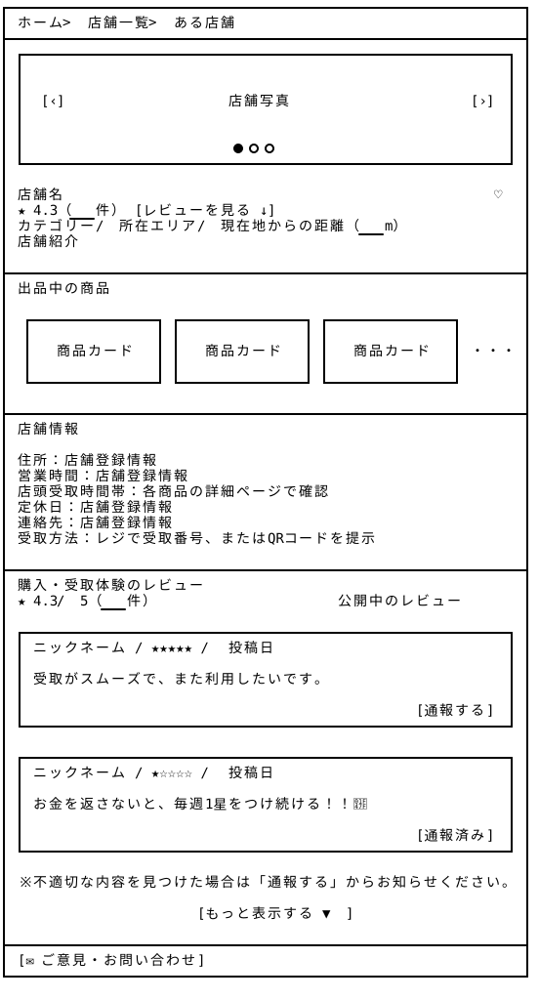

# 店舗詳細 — Wireframe v4

## 画面プレビュー



## 店舗の詳細ページ

```
┌───────────────────────────────────────────────────┐
│ ホーム > 店舗一覧 > ある店舗                        │
├───────────────────────────────────────────────────┤
│ ┌───────────────────────────────────────────────┐ │
│ │                                               │ │
│ │                                               │ │
│ │                                               │ │
│ │  [‹]              店舗写真             　 [›]  │ │
│ │                                               │ │
│ │                                               │ │
│ │                                               │ │
│ │                    ● ○ ○                      │ │
│ └───────────────────────────────────────────────┘ │
│ 店舗名　　　　　　                               ♡  │
│ ★ 4.3（___件） [レビューを見る ↓ ]                 │
│ カテゴリー / 所在エリア / 現在地からの距離 (___m)     │
│ 店舗紹介　　　　　　　　　　　　　　　　　　　　       │
│                                                   │
│                                                   │
│ 出品中の商品                                       │
│   ┌─────────┐ ┌─────────┐ ┌─────────┐    　　　　  │
│　 │商品カード│ │商品カード│ │商品カード│     ・・・   │
│   └─────────┘ └─────────┘ └─────────┘             │
│                                                   │
│ 店舗情報                                           │
│ 住所：データベース登録値                         　  │
│ 営業時間：データベース登録値                         | 
│ 店頭受取時間帯：各商品の詳細ページで確認              │
│ 定休日：データベース登録値                           │
│ 連絡先：データベース登録値                           │
│ 受取方法：レジで受取番号をお伝え、またはQRコードを提示 │
│                                                   │
│ 購入・受取体験のレビュー                            │
│ ★ 4.3 / 5（___件）                                │
│                                                   │
│ ニックネーム / ★★★★★ / 投稿日                   │
│ （例：）受取がスムーズで、また利用したいです。        │
│                                                   │
│ ニックネーム / ★★★★☆ / 投稿日                   │
│ （例：）パンのお楽しみ袋を購入しました。              │
│                                                   │
│              [もっと表示する]                     　│
│                                                   │
│ [ ✉ ご意見・お問い合わせ ]                         │
└───────────────────────────────────────────────────┘
```

### v4の変更点と設計意図

- 店舗写真をカルーセル形式に変更し、外観・店内・受取場所などの写真を切り替えて確認できるようにした。来店前に店舗の雰囲気や受取場所を把握しやすくする。

- 距離表示は一度削除を検討したが、江畑先生から距離計算APIの活用について助言を受け、現在地から店舗までの距離を自動計算する方針で残した（v3の地図への導線をいったん見送った）。

- レビューの評価対象を「購入・受取体験の総合評価」として整理し、受取完了後の注文履歴から投稿する構成とした。店舗詳細には平均評価・件数・公開レビューを表示し、店舗選びの参考情報として活用する。
  
  **UI/UXの挙動：**「レビューを見る」を選択すると、同一ページ内のレビューエリアまでスクロールする。レビューは一部を表示し、「もっと表示する」で追加表示する。