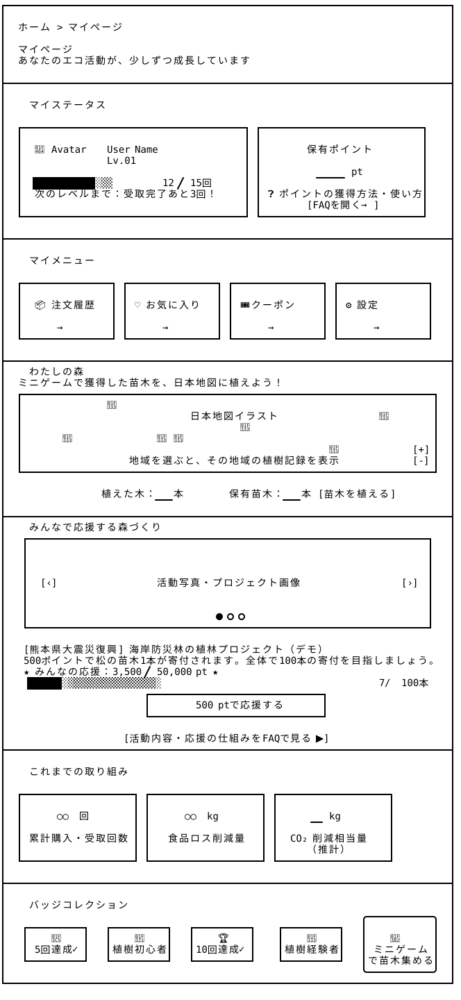

# マイページ — Wireframe v4

## 画面プレビュー



# マイページのワイヤーフレーム図

```
┌────────────────────────────────────────────────────────────────────────────────┐
│                                                                                │
│  ホーム > マイページ                                                            │
│                                                                                │
│  マイページ                                                                     │
│  あなたのエコ活動が、少しずつ成長しています                                        │
│                                                                                │
├────────────────────────────────────────────────────────────────────────────────┤
│                                                                                │
│  ① マイステータス                                                               │
│                                                                                │
│  ┌────────────────────────────────────────┐ ┌─────────────────────────────┐    │
│  │                                        │ │                             │    │
│  │  👤 Avatar    User Name                │ │        保有ポイント          │    │
│  │               Lv.01                    │ │                             │     │
│  │                                        │ │          _____ pt           │    │
│  │  ███████████░░░░░       12 / 15回      │ │                             │    │
│  │  次のレベルまで：受取完了あと3回！        │ │  ⍰ポイントの獲得方法・使い方  │    │
│  │                                        │ │        [FAQを開く →]         │    │
│  └────────────────────────────────────────┘ └─────────────────────────────┘    │
│                                                                                │
├────────────────────────────────────────────────────────────────────────────────┤
│                                                                                │
│  ② マイメニュー                                                                 │
│                                                                                │
│  ┌────────────────┐ ┌────────────────┐ ┌────────────────┐ ┌────────────────┐   │
│  │                │ │                │ │                │ │                │   │
│  │  📦 注文履歴   │ │ ♡ お気に入り    │ │ 🎟 クーポン     │ │ ⚙ 設定         │   │
│  │                │ │                │ │                │ │                │   │
│  │      →         │ │      →         │ │      →         │ │      →         │   │
│  └────────────────┘ └────────────────┘ └────────────────┘ └────────────────┘   │
│                                                                                │
├────────────────────────────────────────────────────────────────────────────────┤
│  ③ わたしの森                                                                   │
│  ミニゲームで獲得した苗木を、日本地図に植えよう！                                  │
│  ┌──────────────────────────────────────────────────────────────────────────┐  │
│  │               🌳                                                         │  │
│  │                              日本地図イラスト                  🌳         │  │
│  │                                       🌳                                 │  │
│  │       🌳               🌳 🌳                                            │  │
│  │                                                       🌳                 │  │
│  │                   地域を選ぶと、その地域の植樹記録を表示                     │  │
│  └──────────────────────────────────────────────────────────────────────────┘  │
│                                                                                │
│                 植えた木：___本        保有苗木：___本 [苗木を植える]             │
│                                                                                │
├────────────────────────────────────────────────────────────────────────────────┤
│  ④ みんなで応援する森づくり                                                      │
│   ┌────────────────────────────────────────────────────────────────────────┐   │
│   │                                                                        │   │
│   │                                                                        │   │
│   │                                                                        │   │
│   │  [‹]                   活動写真・プロジェクト画像             　     [›]  │   │
│   │                                                                        │   │
│   │                                                                        │   │
│   │                                  ● ○ ○                                 │   │
│   └────────────────────────────────────────────────────────────────────────┘   │
│                                                                                │
│   [熊本県大震災復興] 海岸防災林の植林プロジェクト（デモ）                           │
│   500ポイントで松の苗木1本が寄付されます。全体で100本の寄付を目指しましょう。         │
│   ★ みんなの応援：3,500 / 50,000 pt ★                                          │
│    ██████░░░░░░░░░░░░░░░░░░░░░░░░░░░░░░░░░░░░░░░░░░░░░░             7/100本     │
│                         ┌───────────────────────────────┐                      │
│                         │        500 ptで応援する        │                      │
│                         └───────────────────────────────┘                      │
│                                                                                │
│                     [活動内容・応援の仕組みをFAQで見る ▶]                         │
├────────────────────────────────────────────────────────────────────────────────┤
│                                                                                │
│  ③ これまでの取り組み                                                            │
│                                                                                │
│  ┌────────────────────┐ ┌────────────────────┐ ┌────────────────────┐          │
│  │                    │ │                    │ │                    │          │
│  │      ○○ 回         │ │      ○○ kg       　│ │      __ kg         │          │
│  │                    │ │                    │ │                    │          │
│  │  累計購入・受取回数  │ │   食品ロス削減量    │ │  CO₂削減相当量      │          │
│  │                    │ │                    │ │     （推計）        │          │
│  └────────────────────┘ └────────────────────┘ └────────────────────┘          │
│                                                                                │
├────────────────────────────────────────────────────────────────────────────────┤
│                                                                                │
│  バッジコレクション                                                              │
│                                                                ╭────────────╮  │
│   ┌──────────┐   ┌──────────┐   ┌──────────┐    ┌──────────┐   │            │  │
│   │    🏅  　│   │    🌱   │   │    🏆    │    │    🌳   │   │    🎲      │  │
│   │ 5回達成 ✓│   │植樹初心者 │   │10回達成 ✓│   │植樹経験者 │   │  ミニゲーム │  │
│   └──────────┘   └──────────┘   └──────────┘    └──────────┘   │で苗木を集める│  │
│                                                                ╰────────────╯  │
└────────────────────────────────────────────────────────────────────────────────┘
```
### v4の変更点と設計意図

v3のダッシュボード構成を維持しながら、購入・受取による成長、ミニゲームの成果、ポイントによる応援を一つの画面で確認できる構成に見直した。活動の記録だけでなく、次の目標や参加方法を示すことで、継続して利用したくなる体験を目指す。

- **導線の整理と説明の集約**：重複していた「設定」への入口をマイメニュー内に統一し、「ポイント詳細」「バッジ一覧」への独立した画面遷移を削除した。ポイントの獲得方法・使い方は既存のFAQへ集約し、画面数を抑えながら必要な説明を確認できる構成とした。

- **成長目標の明確化**：「マイステータス」では、レベルアップまでの進捗を「受取完了回数」で示し、現在の達成状況と次の目標を把握しやすくした。保有ポイントも同じエリアに配置し、自分の状態をまとめて確認できるようにした。

- **ミニゲームの成果を可視化**：「わたしの森」を追加し、ミニゲームで獲得した苗木を日本地図上に植える構成とした。植えた木の本数・保有苗木・地域別の植樹記録を表示し、ゲームの成果が自分の森として蓄積される楽しさを表現する。

- **共同で参加する応援活動の追加**：「みんなで応援する森づくり」では、活動写真を切り替えるカルーセル、プロジェクトの目標、全体の応援ポイントと進捗、500ポイントで応援する入口を配置した。個人の活動に加え、参加者全体で目標に近づく過程を示す。活動内容と応援の仕組みはFAQで説明し、試作段階ではデモとして扱う。ゲーム内で植えた木と、応援プロジェクトの寄付・植樹実績は区別して表示する。

- **貢献実績と達成感の整理**：購入・受取回数、食品ロス削減量、CO₂削減相当量の表示を維持し、ゲーム内の成果と併せて活動を振り返れる構成とした。従来の達成回数のタイムラインはバッジコレクションに整理し、受取回数に加えて植樹に関するバッジを配置した。ミニゲームへの入口には「苗木を集める」という目的を明示し、成果の確認から次の参加につなげる。

### 追加で設計する画面・表示状態

独立したページを増やしすぎないため、以下の構成を想定する。モーダルやページ内表示も、操作内容と結果が分かるワイヤーフレームを追加する。

| 対象 | 表示方法 | 追加する設計内容 | 作成状態 |
|---|---|---|---|
| ミニゲーム | マイページ上のモーダル | 遊び方、残りプレイ回数、開始・プレイ操作、マイページへ戻る導線 | ワイヤーフレーム段階で作りません |
| 苗木を植える | マイページ上のモーダル | 保有苗木、植える地域の選択、使用する苗木の本数と確定操作。完了時の地図・本数更新と、苗木がない場合の表示も示す。 | ワイヤーフレーム段階で作りません |
| ポイントで応援する | マイページ上の確認モーダル | 対象プロジェクト、使用する500ポイント、使用後の残高、確定・キャンセル。完了時の残高・全体進捗更新に加え、ポイント不足・目標達成済み・処理失敗時の表示も示す | ワイヤーフレーム段階で作りません |

