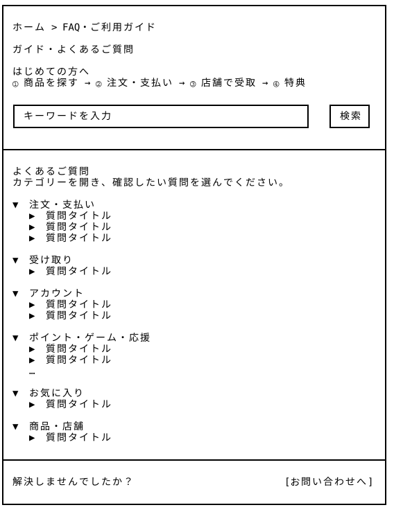

# FAQ・ご利用ガイド — Wireframe v4

## 画面プレビュー



## FAQ・ご利用ガイドのワイヤーフレーム

```
┌────────────────────────────────────────────────────────────────────┐
│                                                                    │
│ ホーム > FAQ・ご利用ガイド                                           │
│                                                                    │
│ ガイド・よくあるご質問                                               │
│                                                                    │
│ はじめての方へ                                                      │
│  ① 商品を探す → ② 注文・支払い → ③ 店舗で受取 　　　　　　　　　　　　　│
|  → ④ ポイントとゲームプレイ回数を獲得 → ⑤ ミニゲームに挑戦      　　　　│
|  → ⑥ 「わたしの森」を育てる、またはチャリティーを応援                  |
│                                                                    │
│ ┌────────────────────────────────────────────────────┐   ┌──────┐  │
│ │ キーワードを入力                                     │  |  検索 |  │
│ └────────────────────────────────────────────────────┘   └──────┘  │
│                                                                    │
├────────────────────────────────────────────────────────────────────┤
│                                                                    │
│ よくあるご質問                                                      │
│ カテゴリーを開き、確認したい質問を選んでください。                      │
│                                                                    │
│ ▼ 注文・支払い                                                      │
│    ▶ 質問タイトル                                                   │
│    ▶ 質問タイトル                                                   │
│    ▶ 質問タイトル                                                   │
│                                                                    │
│ ▼ 受け取り                                                          │
│    ▶ 質問タイトル                                                   │
│                                                                    │
│ ▼ アカウント                                                        │
│    ▶ 質問タイトル                                                   │
│    ▶ 質問タイトル                                                   │
│                                                                    │
│ ▼ ポイント・ゲーム・応援                                             │
│    ▶ 質問タイトル                                                   │
│    ▶ 質問タイトル                                                   │
│    …                                                               │
│                                                                    │
│ ▼ お気に入り                                                        │
│    ▶ 質問タイトル                                                   │
│                                                                    │
│ ▼ 商品・店舗                                                        │
│    ▶ 質問タイトル                                                   │
│                                                                    │
├────────────────────────────────────────────────────────────────────┤
│                                                                    │
│ 解決しませんでしたか？                           [お問い合わせへ]     │
│                                                                    │
└────────────────────────────────────────────────────────────────────┘
```

## 表示・操作仕様

- **階層構造**：第1階層をカテゴリー、第2階層を質問とする。カテゴリーを開閉すると、その中の質問一覧を表示・非表示にする。質問を開閉すると、その回答を表示・非表示にする。

- **初期表示**：すべてのカテゴリーと質問タイトルを一覧表示する。カテゴリーは展開、各質問の回答は折りたたんだ状態とし、複数のカテゴリー・質問を同時に開ける構成とする。

- **検索**：検索ボタンまたはEnterキーで検索する。質問タイトルと回答本文を検索対象とし、既存のFAQ一覧領域を検索結果に置き換える。件数は一致した質問数を表示する。

- **検索結果の表示**：一致した質問のみを、所属するカテゴリーごとに表示する。該当カテゴリーは展開し、回答は折りたたんだ状態とする。一致する質問がないカテゴリーは表示しない。

- **検索の解除**：「検索をクリア」を選択すると、入力内容を消去し、初期表示のFAQ一覧に戻す。検索語が空の場合も初期表示とする。

- **検索結果が0件の場合**：FAQ一覧領域に「該当する質問が見つかりませんでした。別のキーワードで検索してください。」と表示する。検索のクリアとお問い合わせへの導線を残す。

- **他画面からの案内**：マイページなどから特定のFAQを開く場合は、対象カテゴリーと質問を展開し、回答の位置までスクロールする。

- **設計資料の管理**：ASCIIには画面構成と階層関係のみを記載し、質問・回答の全文は「FAQ掲載原稿」に分けて管理する。

## v4の変更点と設計意図

「はじめての方へ」の流れ説明を軽く修正しました。

カテゴリーを選択してFAQを切り替える構成から、カテゴリーと質問による2階層のアコーディオン構成へ変更した。初期表示ではすべてのカテゴリーと質問タイトルを一覧表示し、利用者が全体を見渡しながら必要な回答を開けるようにした。

検索結果は既存のFAQ一覧領域に置き換えて表示し、一致した質問をカテゴリーごとに整理する。検索と一覧閲覧を同じ画面内で切り替えられる構成とした。

また、マイページv4に合わせて、ポイント・ミニゲーム・ゲーム内植樹・応援プロジェクトに関する説明を追加した。ASCIIはレイアウトと操作階層の設計に集中させ、質問・回答の全文は掲載原稿として別項目に整理した。


## FAQ掲載原稿（暫定）

### 1. 注文・支払い

#### 1-1. カートに入れれば商品が確保されますか？

カートに入れた時点では、商品の在庫は確保されません。

在庫は注文時に確認されるため、手続き中に売り切れる場合があります。

#### 1-2. 商品が売り切れたらどうなりますか？

売り切れの商品は購入できません。

カートに入れた後に売り切れた場合は、内容を確認・変更してから注文へ進んでください。

#### 1-3. キャンセル・返金について確認したいです。

注文時に表示される「キャンセル・返金条件」を確認してください。

個別の注文について相談したい場合は、注文詳細の「この注文について問い合わせる」からお問い合わせください。

### 2. 受け取り

#### 2-1. 商品はどこで、どのように受け取りますか？

注文した店舗で、指定の受取時間内に受け取ります。

注文履歴の「受取待ち」から受取画面を開き、店頭で提示してください。

店舗の場所や受取方法は、注文詳細で確認できます。

### 3. アカウント

#### 3-1. ログインしなくても利用できますか？

商品や店舗の情報は、ログインせずに閲覧できます。

注文手続きや注文履歴、お気に入り、マイページなどの会員機能を利用するには、ログインが必要です。

#### 3-2. パスワードを忘れた場合はどうすればよいですか？

ログイン画面の「パスワードを忘れた方」から、登録したメールアドレスを入力してください。

届いた再設定メールから、新しいパスワードを設定できます。

### 4. ポイント・ゲーム・応援

#### 4-1. ポイントはどうすれば獲得できますか？

ポイントは、商品のお買い物やミニゲームで獲得できます。

- お買い物：ポイント利用後のお支払い金額100円ごとに1 ptが付与されます。獲得予定のポイントは注文確認画面で確認でき、商品の受取完了後に反映されます。

- ミニゲーム：ゲームの結果に応じてポイントと苗木を獲得できます。

保有ポイントや獲得・利用履歴は「ポイント詳細」から確認できます。

#### 4-2. ポイントは何に使えますか？

貯まったポイントは、商品購入時の割引、または「みんなで応援する森づくり」への参加に使用できます。

- お買い物に使う：1 pt＝1円分として、注文確認画面で商品代金から割引できます。

- 活動を応援する：1回500 ptを使用して、森づくりの応援プロジェクトに参加できます。

利用したポイントは保有残高から差し引かれ、履歴に記録されます。

※ 応援機能は現在デモとして提供しており、実際の寄付は発生しません。

#### 4-3. 苗木はどうすれば獲得できますか？

マイページの「ミニゲームで苗木を集める」からミニゲームを遊び、結果に応じてポイントと苗木を獲得できます。

獲得した苗木は「わたしの森」の保有苗木に追加されます。

苗木はゲーム内の報酬であり、実物の苗木ではありません。

#### 4-4. 獲得した苗木はどうやって植えますか？

「わたしの森」の「苗木を植える」を選び、植える地域を指定して確定してください。

使用した分の保有苗木が減り、日本地図上の表示と「植えた木」の本数が更新されます。

地図の地域を選ぶと、その地域の植樹記録を確認できます。

苗木がない場合は、ミニゲームで集めてください。

#### 4-5. どのような活動を応援できますか？

森林保全や被災地の復興に関わる活動への応援を想定しています。

現在は、海岸防災林の植林をテーマにしたデモプロジェクトを掲載しています。

実際の支援先となる団体や連携方法は検討中です。

正式に連携する際は、団体名・活動内容・支援方法を案内します。

#### 4-6. 応援ポイントと苗木の寄付は、どう関係していますか？

デモでは、応援ポイント500ptを苗木1本分として換算し、参加者全体で50,000 pt・100本分を目指す設定です。

画面の本数と進捗は、この設定に基づいて表示しています。

実際の苗木の寄付や植樹を行った本数を示すものではありません。

将来の実施に向けて、運営側・協賛企業・支援団体との連携方法を検討しています。

#### 4-7. ゲーム内の植樹やポイントでの応援は、実際の寄付につながりますか？

現在は試作・デモのため、実際の植樹や寄付は行われません。

「わたしの森」は個人のゲーム内の植樹記録、「みんなで応援する森づくり」はポイントによる共同応援の仕組みを体験する機能です。

ゲーム内で植えた木が、そのまま現実の植樹本数やCO₂削減実績として計上されることはありません。

#### 4-8. ポイントに有効期限はありますか？

商品のお買い物やミニゲームで獲得したポイントに有効期限はありません。

ただし、退会すると保有ポイントは失効し、復元できません。

### 5. お気に入り

#### 5-1. 商品や店舗をお気に入りに登録するには？

ログインした状態で、商品や店舗のハートアイコンを選択してください。

登録した内容は「お気に入り」の商品タブ・店舗タブで確認できます。

### 6. 商品・店舗

#### 6-1. アレルギーや消費期限、店舗の情報はどこで確認できますか？

アレルギー、保存方法、消費期限などは商品詳細で確認できます。

店舗の住所、営業時間、受取方法などは店舗詳細を確認してください。
