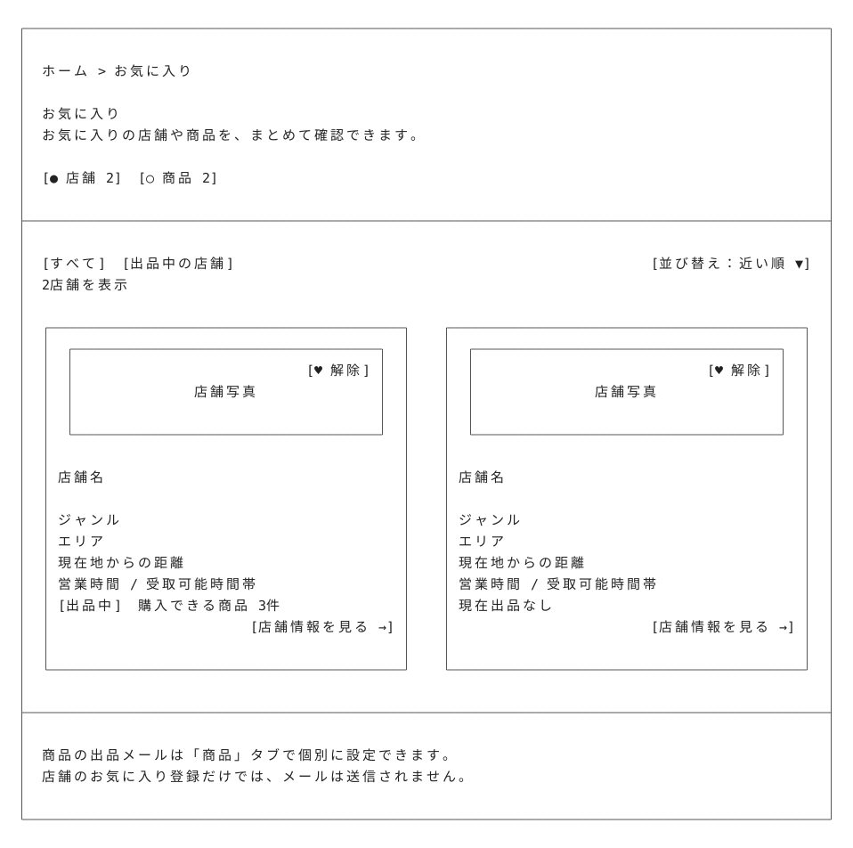
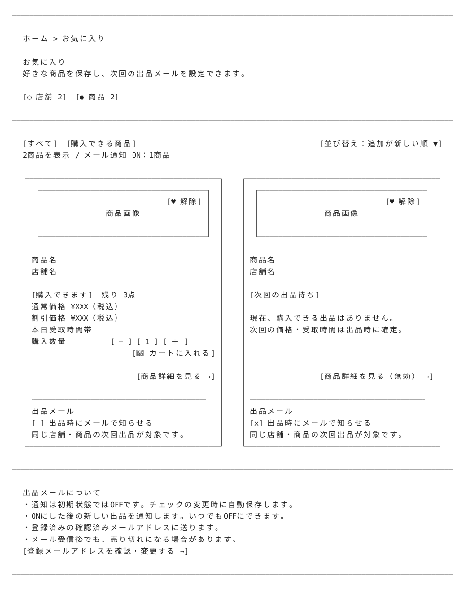

# お気に入り — Wireframe v4

## 画面プレビュー





## 共通レイアウトとの役割分担

お気に入りの店舗・商品を確認するログイン済みユーザー向けのページ。ヘッダー・フッターは[共通レイアウト](../../00_common/v4/README.md)で管理し、以下はメインコンテンツを示す。未ログインでアクセスした場合は[ログイン画面](../../12_login/v4/README.md)へ案内し、ログイン後に本ページへ戻る。

## 1. 店舗タブON

```text
┌────────────────────────────────────────────────────────────────────────────────────────────────────┐
│                                                                                                    │
│  ホーム > お気に入り                                                                                 │
│                                                                                                    │
│  お気に入り                                                                                        │
│  お気に入りの店舗や商品を、まとめて確認できます。                                                      │   
│                                                                                                    │
│  [● 店舗 2]  [○ 商品 2]                                                                            │
│                                                                                                    │
├────────────────────────────────────────────────────────────────────────────────────────────────────┤
│                                                                                                    │
│  [すべて]  [出品中の店舗]                                                       [並び替え：近い順 ▼]  │
│  2店舗を表示                                                                                       │
│                                                                                                    │
│  ┌────────────────────────────────────────────┐    ┌────────────────────────────────────────────┐  │
│  │  ┌──────────────────────────────────────┐  │    │  ┌──────────────────────────────────────┐  │  │
│  │  │                             [♥ 解除] │  │    │  │                              [♥ 解除] │  │  │
│  │  │               店舗写真                │  │    │  │               店舗写真                │  │  │
│  │  │                                      │  │    │  │                                      │  │  │
│  │  └──────────────────────────────────────┘  │    │  └──────────────────────────────────────┘  │  │
│  │                                            │    │                                            │  │
│  │ 店舗名                                     │    │ 店舗名                                      │  │
│  │                                            │    │                                            │  │
│  │ ジャンル                                   │    │ ジャンル                                    │  │
│  │ エリア                                     │    │ エリア                                      │  │
│  │ 現在地からの距離                            │    │ 現在地からの距離                             │  │
│  │ 営業時間 / 受取可能時間帯                   │    │ 営業時間 / 受取可能時間帯                     │  │
│  │ [出品中]  購入できる商品 3件                │    │ 現在出品なし                                 │  │
│  │                          [店舗情報を見る →] │    │                           [店舗情報を見る →] │  │
│  │                                            │    │                                            │  │
│  └────────────────────────────────────────────┘    └────────────────────────────────────────────┘  │
│                                                                                                    │
├────────────────────────────────────────────────────────────────────────────────────────────────────┤
│                                                                                                    │
│  商品の出品メールは「商品」タブで個別に設定できます。                                                   │
│  店舗のお気に入り登録だけでは、メールは送信されません。                                                 │
│                                                                                                    │
└────────────────────────────────────────────────────────────────────────────────────────────────────┘
```

店舗写真・店舗名・ジャンル・エリア・距離・営業時間／受取可能時間帯・出品状態と、店舗詳細への入口を表示する。出品がなくても店舗詳細は開ける。店舗の保存と商品のメール通知は別の操作とし、このタブには店舗単位の通知スイッチを設けない。

## 2. 商品タブON

```text
┌────────────────────────────────────────────────────────────────────────────────────────────────────┐
│                                                                                                    │
│  ホーム > お気に入り                                                                                │
│                                                                                                    │
│  お気に入り                                                                                        │
│  好きな商品を保存し、次回の出品メールを設定できます。                                                  │
│                                                                                                    │
│  [○ 店舗 2]  [● 商品 2]                                                                            │
│                                                                                                    │
├────────────────────────────────────────────────────────────────────────────────────────────────────┤
│                                                                                                    │
│  [すべて]  [購入できる商品]                                              [並び替え：追加が新しい順 ▼]  │
│  2商品を表示 / メール通知 ON：1商品                                                                   │
│                                                                                                    │
│  ┌────────────────────────────────────────────┐    ┌────────────────────────────────────────────┐  │
│  │  ┌──────────────────────────────────────┐  │    │  ┌──────────────────────────────────────┐  │  │
│  │  │                             [♥ 解除] │  │    │  │                              [♥ 解除] │  │  │
│  │  │               商品画像                │  │    │  │                商品画像               │  │  │
│  │  │                                      │  │    │  │                                      │  │  │
│  │  └──────────────────────────────────────┘  │    │  └──────────────────────────────────────┘  │  │
│  │                                            │    │                                            │  │
│  │ 商品名                                     │    │  商品名                                     │  │
│  │ 店舗名                                     │    │  店舗名                                     │  │
│  │                                            │    │                                            │  │
│  │ [購入できます]  残り 3点                    │    │ [次回の出品待ち]                             │  │
│  │ 通常価格 ¥XXX（税込）                       │    │                                            │  │
│  │ 割引価格 ¥XXX（税込）                       │    │ 現在、購入できる出品はありません。            │  │
│  │ 本日受取時間帯                             │    │ 次回の価格・受取時間は出品時に確定。           │  │
│  │ 購入数量               [ − ] [ 1 ] [ ＋ ]  │    │                                            │  │
│  │                        [🛒 カートに入れる] │    │                                            │  │
│  │                                            │    │                                            │  │
│  │                          [商品詳細を見る →] │    │                    [商品詳細を見る（無効） →] │  │
│  │                                            │    │                                            │  │
│  │ ────────────────────────────────────────   │    │ ────────────────────────────────────────   │  │
│  │ 出品メール                                  │    │ 出品メール                                  │  │
│  │ [ ] 出品時にメールで知らせる                  │    │ [x] 出品時にメールで知らせる                │  │
│  │ 同じ店舗・商品の次回出品が対象です。           │    │ 同じ店舗・商品の次回出品が対象です。         │  │
│  └────────────────────────────────────────────┘    └────────────────────────────────────────────┘  │
│                                                                                                    │
├────────────────────────────────────────────────────────────────────────────────────────────────────┤
│                                                                                                    │
│  出品メールについて                                                                                  │
│  ・通知は初期状態ではOFFです。チェックの変更時に自動保存します。                                         │
│  ・ONにした後の新しい出品を通知します。いつでもOFFにできます。                                           │
│  ・登録済みの確認済みメールアドレスに送ります。                                                         │
│  ・メール受信後でも、売り切れになる場合があります。                                                     │
│  [登録メールアドレスを確認・変更する →]                                                               │
│                                                                                                    │
└────────────────────────────────────────────────────────────────────────────────────────────────────┘
```

左は「購入可能・メール通知OFF」、右は「次回出品待ち・メール通知ON」の表示例。チェックボックスは現在の設定を表し、`[ ]`がOFF、`[x]`がON。名称・価格・数量・距離・日時・件数は表示例。

| エリア | 機能・設計方針 |
|---|---|
| ページタイトル・タブ | 店舗／商品を切り替える。タブの件数は保存中の総数で、絞り込み後の表示件数は一覧の上に示す。 |
| 店舗の絞り込み・並び替え | 「すべて」「出品中の店舗」を切り替える。「近い順」は現在地を利用できる場合に使用し、利用できない場合は距離を「—」とし、追加が新しい順で表示する。位置情報の再取得を強制しない。 |
| 商品の絞り込み・並び替え | 「すべて」「購入できる商品」を切り替える。初期表示は追加が新しい順。同じ店舗・商品は1カードにまとめ、現在の購入可否を反映する。 |
| 購入可能な商品 | 通常価格・割引価格・残数・受取時間を表示する。数量を選んでカートに追加するか、商品詳細へ進める。数量は1～残数とし、追加時に最新の在庫を確認する。同じ店舗・商品に複数の購入可能な出品がある場合は、受取終了時刻が最も近い出品を代表として表示し、その出品詳細を開く。 |
| 次回出品待ちの商品 | 売り切れや出品終了後もカードを残す。前回の価格や受取時間を今回の情報として表示しない。購入可能な出品がない間は商品詳細の入口を無効にし、メール設定とお気に入り解除は操作できる。 |
| 出品メール | 商品カードごとにON／OFFを設定する。初期状態はOFF。現在購入できる商品でも、次回出品待ちの商品でも設定できる。OFFへの変更時は、その商品の未送信通知も取り消す。ON件数は絞り込みにかかわらず保存中の全商品を対象に数える。 |
| お気に入り解除 | ハートの「解除」で対象を一覧から外し、件数を更新する。商品の解除時はその商品のメール設定もOFFにし、未送信の通知を取り消す。再登録時はOFFから始める。 |

※ 店舗のお気に入り解除だけでは、別に保存した商品のお気に入り・メール設定は変更しない。

## 3. 出品メールのルール

**通知ON → 同じ店舗・商品の新規出品が購入可能になる → メール送信**

| 項目 | ルール |
|---|---|
| 対象 | 店舗ID＋商品マスターIDで保存した商品。他店舗の商品は対象外。 |
| タイミング | ON後の新規出品が初めて購入可能になった時点で対象者を記録する。既存出品への後付け通知や、編集・在庫回復による再通知はしない。 |
| 送信前の確認 | 通知OFF・お気に入り解除・退会・売り切れ・出品停止・期限切れなら送らない。 |
| 宛先 | 現在有効な確認済み登録メールアドレス。変更確認中は元のアドレスを使う。 |
| 本文・リンク | 店舗名・商品名・販売価格・受取日時と、対象出品・通知設定へのリンク。在庫保証がないことも伝える。未ログイン時はログイン後に戻る。 |
| 送信処理 | 出品保存の確定後にバックグラウンド送信。ユーザーID＋出品IDで重複を防ぐ。失敗は記録して回数制限付きで再試行し、出品処理には影響させない。 |

店舗全体の通知、価格変動通知、まとめ配信、サイト内通知は初期版の対象外。

## 4. 状態・エラー表示

| 状態 | 対応 |
|---|---|
| 通知設定の保存中・完了 | 対象のチェックだけを一時無効にし、保存後にON／OFFの完了を表示する。 |
| 設定保存・お気に入り解除の失敗 | 変更前の状態を保ち、エラーと再試行を案内する。 |
| メール未確認 | 通知ONを無効にし、確認メールの再送を案内する。 |
| 保存0件／絞り込み0件 | 商品・店舗を探す入口／「すべてのお気に入りを見る」を表示する。 |
| 一覧取得失敗 | 再読み込みを表示し、件数は「—」とする。 |
| 商品・店舗が利用不可 | 詳細表示と新たな通知を停止する。通知OFF・お気に入り解除は可能。 |

設定は端末をまたいで保存する。通知先の変更は[アカウント設定](../../21_account_setting/v4/README.md)で行う。

## 5. 開発・デモの確認

仮のメールアドレスはMailpitなどのテスト受信箱で確認する。実際のメール配信テストとは区別する。

- **送信対象**：ON後の同一店舗・商品の新規出品で届く。OFF・他店舗・編集・在庫回復では届かない。
- **停止・重複**：送信前のOFF・解除・売り切れで停止し、同じ通知を重複作成しない。
- **リンク・失敗**：対象出品の最新状態を開ける。送信失敗でも出品は保存される。

## 6. v4の変更点

- 写真・店舗情報・価格・数量選択・カートへの追加をカード内に整理。
- 商品ごとの任意の出品メールを追加。出品終了後も保存して次回を待てる設計。
