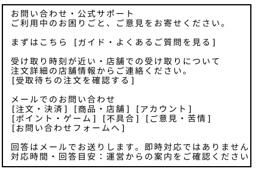
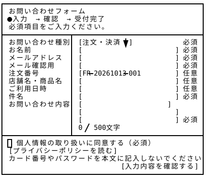
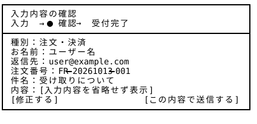
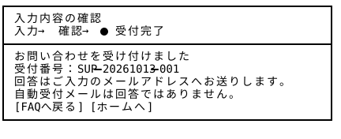

# お問い合わせ — Wireframe v3

## 画面プレビュー









## 7-1. 入口ページ

```
┌───────────────────────────────────────────────────┐
│ お問い合わせ・公式サポート                        　 │
│ ご利用中のお困りごと、ご意見をお寄せください。   　　  │
│                                                   │
│ まずはこちら [ガイド・よくあるご質問を見る]       　  │
│                                                   │
│ 受け取り時刻が近い・店舗での受け取りについて      　  │
│ 注文詳細の店舗情報からご連絡ください。            　 │
│ [受取待ちの注文を確認する]                        　│
│                                                   │
│ メールでのお問い合わせ                            　│
│ [注文・決済] [商品・店舗] [アカウント]              │
│ [ポイント・ゲーム] [不具合] [ご意見・苦情]        　 │
│ [お問い合わせフォームへ]                         　 │
│                                                   │
│ 回答はメールでお送りします。即時対応ではありません。　 │
│ 対応時間・回答目安：運営からの案内をご確認ください。　 │
└───────────────────────────────────────────────────┘
```

技術的な制約により、初期バージョンではリアルタイムチャットによるカスタマーサポートは導入せず、メールでのお問い合わせ対応を基本とする。

受け取り待ちの注文に関する直近のお問い合わせについては、店舗の連絡先へ誘導する。一方、プラットフォーム上の決済、アカウント管理、苦情・トラブルなどについては、運営側へのお問い合わせフォームから相談できる仕様とする。

また、ログインに失敗したユーザーもサポートを受けられるよう、お問い合わせフォームは未ログイン状態でもアクセス可能とする。

将来的には、AIチャット機能の導入を検討し、「チャットで相談」を新たに追加する予定である。その際もメールによるお問い合わせ窓口は引き続き設置し、AIでは対応が難しい問題については、有人サポートへ引き継げる仕組みを目指す。

## 7-2. 問い合わせフォームの一連のページ

### 7-2-1. 入力

```
┌───────────────────────────────────────────────────┐
│ お問い合わせフォーム                        　　    │
│ ●①入力 → ②確認 → ③受付完了                     　　 │
│ 必須項目をご入力ください。                       　  │
├─────────────────┬─────────────────────────────────┤
│ お問い合わせ種別 │ [注文・決済 ▼]            　 必須 │
│ お名前          │ [                         ] 必須 │
│ メールアドレス  │ [                          ] 必須 │
│ メール確認用    │ [                          ] 必須 │
│ 注文番号        │ [FR-20261013-001          ] 任意 │
│ 店舗名・商品名  │ [                         ] 任意 │
│ ご利用日時      │ [                         ] 任意 │
│ 件名            │ [                         ] 必須 │
│ お問い合わせ内容│ [                         ] 　　　 │
│                 │ [                         ]      │
│                 │ [                         ] 必須 │
│                 │ 0 / 500文字                　    │
├─────────────────┴─────────────────────────────────┤
│ □ 個人情報の取り扱いに同意する（必須）          　   │
│ [プライバシーポリシーを読む]                        │
│ カード番号やパスワードを本文に記入しないでください。　 │
│                   　           [入力内容を確認する] │
└───────────────────────────────────────────────────┘
```

### 7-2-2. 送信確認

```
┌───────────────────────────────────────────────────┐
│ 入力内容の確認                                     │
│ ①入力 → ●②確認 → ③受付完了                  　　    │
├───────────────────────────────────────────────────┤
│ 種別：注文・決済                                   │
│ お名前：ユーザー名                                 │
│ 返信先：user@example.com                          │
│ 注文番号：FR-20261013-001                          │
│ 件名：受け取りについて                           　 │
│ 内容：[入力内容を省略せず表示]                    　 │
│ [修正する]         　          [この内容で送信する]  │
└───────────────────────────────────────────────────┘
```

### 7-2-3. 受付完了

```
┌───────────────────────────────────────────────────┐
│ 入力内容の確認                                     │
│ ①入力 → ②確認 → ●③受付完了                  　　    │
├───────────────────────────────────────────────────┤
│ お問い合わせを受け付けました                     　  │
│ 受付番号：SUP-20261013-001                         │
│ 回答はご入力のメールアドレスへお送りします。      　  │
│ 自動受付メールは回答ではありません。               　│
│ [FAQへ戻る] [ホームへ]                             │
└───────────────────────────────────────────────────┘
```

参考：[7-Eleven お客様相談室入口](https://faq.sej.co.jp/contact/)
