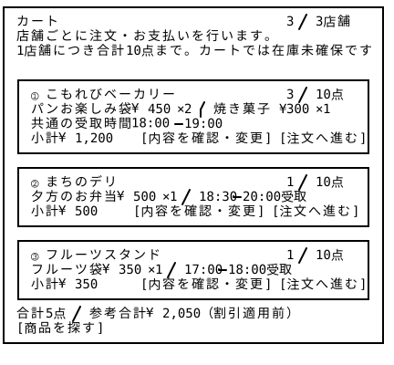
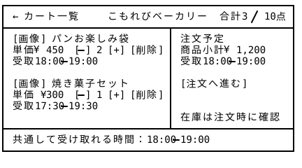
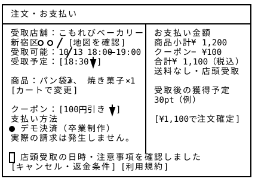
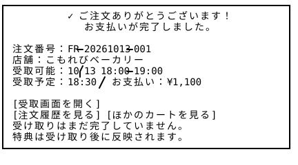

# カート・注文・決済 — Wireframe v3

流れ：①カート → ②注文内容確認 → ③決済完了、店舗へ受取準備

## 画面プレビュー









## 8-1. カート全体

```
┌───────────────────────────────────────────────────┐
│ カート                       3 / 3店舗             │
│ 店舗ごとに注文・お支払いを行います。              　 │
│ 1店舗につき合計10点まで。カートでは在庫未確保です。　　│
│                                                   │
│ ┌───────────────────────────────────────────────┐ │
│ │ ① こもれびベーカリー             3 / 10点     　│ │
│ │ パンお楽しみ袋 ¥450 ×2 / 焼き菓子 ¥300 ×1    　 │ │
│ │ 共通の受取時間 18:00–19:00                  　 │ │
│ │ 小計 ¥1,200 　    [内容を確認・変更] [注文へ進む]│ │
│ └───────────────────────────────────────────────┘ │
│ ┌───────────────────────────────────────────────┐ │
│ │ ② まちのデリ                  　   1 / 10点    │ │
│ │ 夕方のお弁当 ¥500 ×1 / 18:30–20:00受取    　   │ │
│ │ 小計 ¥500     　 [内容を確認・変更] [注文へ進む] │ │
│ └───────────────────────────────────────────────┘ │
│ ┌───────────────────────────────────────────────┐ │
│ │ ③ フルーツスタンド              　 1 / 10点     │ │
│ │ フルーツ袋 ¥350 ×1 / 17:00–18:00受取      　    │ │
│ │ 小計 ¥350     　　 [内容を確認・変更] [注文へ進む]│ │
│ └───────────────────────────────────────────────┘ │
│ 合計5点 / 参考合計 ¥2,050（割引適用前）          　  │
│ [商品を探す]                                    　 │
└───────────────────────────────────────────────────┘
```


## 8-2. 店舗ごとのカート詳細

```
┌───────────────────────────────────────────────────┐
│ ← カート一覧   　こもれびベーカリー   合計3 / 10点   │
├─────────────────────────────┬─────────────────────┤
│ [画像] パンお楽しみ袋         │ 注文予定            │
│ 単価 ¥450  [-] 2 [+] [削除]  │ 商品小計 ¥1,200     │
│ 受取18:00–19:00              │ 受取18:00–19:00     │
│                             │                     │
│ [画像] 焼き菓子セット         │ [注文へ進む]        │
│ 単価 ¥300  [-] 1 [+] [削除] │                     │
│ 受取17:30–19:30             │                     │
│                             │ 　在庫は注文時に確認  │
├─────────────────────────────┴─────────────────────┤
│ 共通して受け取れる時間：18:00–19:00          　     │
└───────────────────────────────────────────────────┘
```

## 8-3. 注文確認

```
┌───────────────────────────────────────────────────┐
│ 注文・お支払い                                 　   │
├─────────────────────────────┬─────────────────────┤
│ 受取店舗：こもれびベーカリー   │ お支払い金額         │
│ 新宿区○○ / [地図を確認]     　│ 商品小計 ¥1,200      │
│ 受取可能：10/13 18:00–19:00  │ ポイント −¥100       │
│ 受取予定：[18:30 ▼]          │ 合計 ¥1,100（税込）  │
│                             │ 送料なし・店頭受取    │
│ 商品：パン袋×2、焼き菓子×1  　│                     │
│ [カートで変更]             　│ 受取後の獲得予定      │
│                             │ 11pt                │
│ ポイント：[100pt ▼] 利用   　 │                     │
│ 支払い方法                   │ [¥1,100で注文を確定] │
│ ● デモ決済（卒業制作）      　│                     │
│ 実際の請求は発生しません。  　 │                     │
│                             │                     │
├─────────────────────────────┴─────────────────────┤
│ [キャンセル・返金条件] [利用規約]               　   │
└───────────────────────────────────────────────────┘
```

## 8-4. 注文完了UI

```
┌───────────────────────────────────────────────────┐
│           ✓ ご注文ありがとうございます！          　│
│              お支払いが完了しました。           　  │
│                                                   │
│ 注文番号：FR-20261013-001                          │
│ 店舗：こもれびベーカリー                            │
│ 受取可能：10/13 18:00–19:00                        │
│ 受取予定：18:30 / お支払い：¥1,100               　 │
│                                                   │
│ [受取画面を開く]                                   │
│ [注文履歴を見る] [ほかのカートを見る]             　 │
│ 受け取りはまだ完了していません。                  　 │
│ 特典は受け取り後に反映されます。                  　 │
└───────────────────────────────────────────────────┘
```
