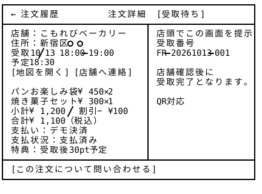
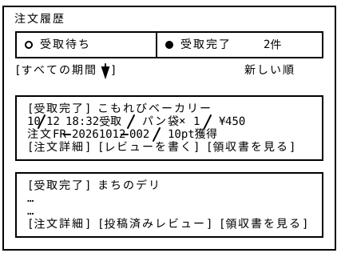
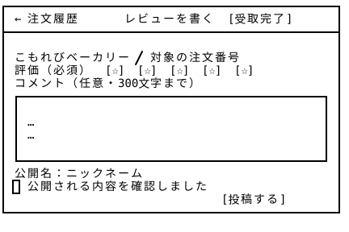

# 注文履歴 — Wireframe v3

## 画面プレビュー










## 9-1. 受取待ちON

```
┌───────────────────────────────────────────────────┐
│ 注文履歴                                           │
│ ┌─────────────────────┬─────────────────────────┐ │
│ │ ● 受取待ち 2件       │ ○ 受取完了            　 │ │
│ └─────────────────────┴─────────────────────────┘ │
│ 受取終了時刻が近い順                          　    │
│                                                   │
│ ┌───────────────────────────────────────────────┐ │
│ │ [受取待ち] こもれびベーカリー                 　 │ │
│ │ [画像] パンお楽しみ袋×2 / 焼き菓子×1         　　│ │
│ │ 本日18:00–19:00 / 予定18:30 / 3点 ¥1,100     　│ │
│ │ 新宿○○ / 注文FR-20261013-001                 　│ │
│ │ [受取画面を開く] [注文詳細]                   　│ │
│ └───────────────────────────────────────────────┘ │
│ ┌───────────────────────────────────────────────┐ │
│ │ [受取待ち] まちのデリ                         　│ │
│ │ 夕方のお弁当×1 / 本日18:30–20:00 / ¥500     　  │ │
│ │ [受取画面を開く] [注文詳細]                  　 │ │
│ └───────────────────────────────────────────────┘ │
│ [キャンセル・受取期限切れの注文を見る]             　 │
└───────────────────────────────────────────────────┘
```

※ 受取待ちの商品がないの場合は`受取待ちの注文はありません。[近くの商品を探す]`と表示！

```
┌───────────────────────────────────────────────────┐
│ ← 注文履歴          注文詳細 [受取待ち]         　  │
├─────────────────────────────┬─────────────────────┤
│ 店舗：こもれびベーカリー      │ 店頭でこの画面を提示　│
│ 住所：新宿区○○            　 │ 受取番号           　│
│ 受取10/13 18:00–19:00       │ FR-20261013-001     │
│ 予定18:30                   │                     │
│ [地図を開く] [店舗へ連絡]    │ 店舗確認後に       　 │
│                            │ 受取完了となります。　 │
│ パンお楽しみ袋 ¥450×2       │                      │
│ 焼き菓子セット ¥300×1       │ QR対応　　　　　　   　│
│ 小計¥1,200 / 割引−¥100      │ 　　　　　　　　   　 │
│ 合計¥1,100（税込）          │                     │
│ 支払い：デモ決済           　│                     │
│ 支払状況：支払済み           │                     │
│ 特典：受取後30pt予定         │                     │
├─────────────────────────────┴─────────────────────┤
│ [この注文について問い合わせる]                　　   │
└───────────────────────────────────────────────────┘
```

## 9-2. 受取完了ON

```
┌───────────────────────────────────────────────────┐
│ 注文履歴                                           │
│ ┌─────────────────────┬─────────────────────────┐ │
│ │ ○ 受取待ち      　　 │ ● 受取完了     2件     　│ │
│ └─────────────────────┴─────────────────────────┘ │
│ [すべての期間 ▼]                  　新しい順        │
│                                                   │
│ ┌───────────────────────────────────────────────┐ │
│ │ [受取完了] こもれびベーカリー              　    │ │
│ │ 10/12 18:32受取 / パン袋×1 / ¥450          　  │ │
│ │ 注文FR-20261012-002 / 10pt獲得              　 │ │
│ │ [注文詳細] [レビューを書く] [領収書を見る]    　 │ │
│ └───────────────────────────────────────────────┘ │
│ ┌───────────────────────────────────────────────┐ │
│ │ [受取完了] まちのデリ 　　　　　　　          　 │ │
│ │ …　　　　　　　　　　　　　　　　　　         　  │ │
│ │ …　　　　　　　　　　　　　　　　　　         　  │ │
│ │ [注文詳細] [投稿済みレビュー] [領収書を見る]  　　│ │
│ └───────────────────────────────────────────────┘ │
└───────────────────────────────────────────────────┘

┌───────────────────────────────────────────────────┐
│ ← 注文履歴          注文詳細 [受取完了]         　  │
├───────────────────────────────────────────────────┤
│ こもれびベーカリー / 10/12 18:32受取済み          　│
│ 注文番号 / 商品一覧 / 単価 / 数量 / 値引き / 合計　  │
│ 支払方法 / 支払日時 / 受取日時                      │
│ 特典：10pt付与済み                                 │
│ [レビューを書く] [領収書を見る] [店舗を見る]         │
│ [この注文について問い合わせる]                 　　  │
└───────────────────────────────────────────────────┘

┌───────────────────────────────────────────────────┐
│ ← 注文履歴          レビューを書く [受取完了]    　  │
├───────────────────────────────────────────────────┤
│                                    　             │
│ こもれびベーカリー / 対象の注文番号             　   │
│ 評価（必須） [☆] [☆] [☆] [☆] [☆]               │
│ コメント（任意・300文字まで）                   　   │
│ ┌───────────────────────────────────────────────┐ │
│ │                      　　　　　　　          　 │ │
│ │ …　　　　　　　　　　　　　　　　　　         　  │ │
│ │ …　　　　　　　　　　　　　　　　　　         　  │ │
│ │                      　　　　　　　          　 │ │
│ └───────────────────────────────────────────────┘ │
│ 公開名：ニックネーム                             　 │
│ □ 公開される内容を確認しました                    　 │
│                                 [投稿する]         │
└───────────────────────────────────────────────────┘

┌───────────────────────────────────────────────────┐
│ ← 注文履歴          領収書 [受取完了]           　  │
├───────────────────────────────────────────────────┤
│                                                   │
│ 領収書番号 / 発行日 / 注文番号 / 発行者情報          │
│ 宛名（対応する場合）                             　 │
│ 商品明細 / 数量 / 値引き / お支払い総額              │
│ 支払い方法 / 支払い日時                         　  │
│ [印刷する]                      [注文詳細に戻る]  　│
│ デモの場合：サンプル・実際の取引証明ではありません　　 │
└───────────────────────────────────────────────────┘
```

v3では、基本構成を維持しつつ、共通Headerの追加、ボタンの配置・表記の調整、入力フォームの追加・修正など、UIの細部を見直した。これにより、画面間のデザインの一貫性と操作性の向上を図った。
