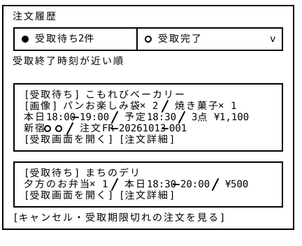
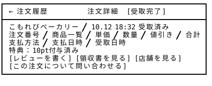
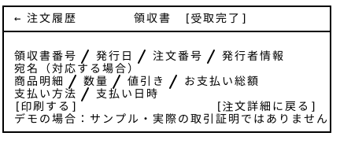

# 注文履歴 — Wireframe v4

## 画面プレビュー









## 共通レイアウトとの役割分担

ヘッダー・フッター・通知／カート／アカウントのドロワーは[共通レイアウト v4](../../00_common/v4/README.md)を使用する。以下の注文一覧・注文詳細／受取画面・レビュー・領収書は、いずれも共通レイアウトのメインコンテンツ領域に表示し、図で省略されている共通部分も組み合わせて実装する。

注文履歴はログイン済み利用者向けの独立したページ群とし、タブ切替や各注文の操作はページ側で管理する。共通アカウントドロワーの「注文履歴」や通知ドロワーの「注文詳細を見る」から開く際はドロワーを閉じ、通知からは対象注文の詳細を表示する。未ログイン時は[ログイン](../../12_login/v4/README.md)へ案内し、ログイン後に対象画面へ戻る。

## 1. 受取待ちON

```
┌───────────────────────────────────────────────────┐
│ 注文履歴                                           │
│ ┌─────────────────────┬─────────────────────────┐ │
│ │ ● 受取待ち 2件       │ ○ 受取完了            　 │ │
│ └─────────────────────┴─────────────────────────┘ │
│ 受取終了時刻が近い順                          　    │
│                                                   │
│ ┌───────────────────────────────────────────────┐ │
│ │ 店舗名                                      　 │ │
│ │ [画像] パンお楽しみ袋×2 / 焼き菓子×1         　　│ │
│ │ 本日18:00–19:00 / 予定18:30 / 3点 ¥1,100     　│ │
│ │ 新宿○○ / 注文FR-20261013-001                 　│ │
│ │                              [受取・注文詳細] 　│ │
│ └───────────────────────────────────────────────┘ │
│ ┌───────────────────────────────────────────────┐ │
│ │ [受取待ち] まちのデリ                         　│ │
│ │ 夕方のお弁当×1 / 本日18:30–20:00 / ¥500     　  │ │
│ │                              [受取・注文詳細]　 │ │
│ └───────────────────────────────────────────────┘ │
│ [キャンセル・受取期限切れの注文を見る]             　 │
└───────────────────────────────────────────────────┘
```

※ 受取待ちの商品がないの場合は`受取待ちの注文はありません。[近くの商品を探す]`と表示！

```
┌───────────────────────────────────────────────────┐
│ ← 注文履歴          注文詳細 [受取待ち]         　  │
├─────────────────────────────┬─────────────────────┤
│ 店舗名                      │ 店頭でこの画面を提示　│
│ 住所                     　 │ 受取番号：           │
│ 受取可能時間帯               │ FR-20261013-001     │
│ 受取予定時間                 │                     │
│ 店舗連絡先                   │ 店舗確認後に       　│
│                             │ 受取完了となります。　│
│ 注文詳細                     │                     │
│ - 商品名  ¥値段 × 数量       │                     │
│ - 商品名  ¥値段 × 数量       │ QR対応　　　　　　   │
│        -------------------- │                     │
│ 小計¥1,200 / 割引−¥100      │ 　　　　　　　　   　 │
│ 合計¥1,100（税込）          │                     │
│ 支払い：デモ決済           　│                     │
│ 支払状況：支払済み           │                     │
│ 特典：受取後11pt予定         │                     │
├─────────────────────────────┴─────────────────────┤
│ [この注文について問い合わせる]                　　   │
└───────────────────────────────────────────────────┘
```

## 2. 受取完了ON

```
┌───────────────────────────────────────────────────┐
│ 注文履歴                                           │
│ ┌─────────────────────┬─────────────────────────┐ │
│ │ ○ 受取待ち      　　 │ ● 受取完了     2件     　│ │
│ └─────────────────────┴─────────────────────────┘ │
│ [すべての期間 ▼]                  　新しい順        │
│                                                   │
│ ┌───────────────────────────────────────────────┐ │
│ │ [受取完了] こもれびベーカリー              　    │ │
│ │ 10/12 18:32受取 / パン袋×1 / ¥450          　  │ │
│ │ 注文FR-20261012-002 / 5pt獲得               　 │ │
│ │ [注文詳細] [レビューを書く] [領収書を見る]    　 │ │
│ └───────────────────────────────────────────────┘ │
│ ┌───────────────────────────────────────────────┐ │
│ │ [受取完了] まちのデリ 　　　　　　　          　 │ │
│ │ …　　　　　　　　　　　　　　　　　　         　  │ │
│ │ …　　　　　　　　　　　　　　　　　　         　  │ │
│ │ [注文詳細] [投稿済みレビュー] [領収書を見る]  　　│ │
│ └───────────────────────────────────────────────┘ │
└───────────────────────────────────────────────────┘

┌───────────────────────────────────────────────────┐
│ ← 注文履歴          注文詳細 [受取完了]         　  │
├───────────────────────────────────────────────────┤
│ こもれびベーカリー / 10/12 18:32受取済み          　│
│ 注文番号 / 商品一覧 / 単価 / 数量 / 値引き / 合計　  │
│ 支払方法 / 支払日時 / 受取日時                      │
│ 特典：5pt付与済み                                  │
│ [レビューを書く] [領収書を見る] [店舗を見る]         │
│ [この注文について問い合わせる]                 　　  │
└───────────────────────────────────────────────────┘

┌───────────────────────────────────────────────────┐
│ ← 注文履歴       レビューを書く [受取完了]    　     │
├───────────────────────────────────────────────────┤
│                                    　             │
│ こもれびベーカリー / 対象の注文番号             　   │
│ 評価（必須） [☆] [☆] [☆] [☆] [☆]               │
│ コメント（任意・300文字まで）                   　   │
│ ┌───────────────────────────────────────────────┐ │
│ │  購入・受取体験のレビューを書こう！　          　 │ │
│ │ …　　　　　　　　　　　　　　　　　　         　  │ │
│ │ …　　　　　　　　　　　　　　　　　　         　  │ │
│ │                      　　　　　　　          　 │ │
│ └───────────────────────────────────────────────┘ │
│ □ 公開される内容を確認しました                    　 │
│                                    　             │
│                                       [投稿する]   │
│                                    　             │
└───────────────────────────────────────────────────┘

┌───────────────────────────────────────────────────┐
│ ← 注文履歴          領収書 [受取完了]           　  │
├───────────────────────────────────────────────────┤
│                                                   │
│ 領収書番号 / 発行日 / 注文番号 / 発行者情報          │
│ 宛名（対応する場合）                             　 │
│ 商品明細 / 数量 / 値引き / お支払い総額              │
│ 支払い方法 / 支払い日時                         　  │
│                                    　             │
│                                              　　 │
└───────────────────────────────────────────────────┘
```

v3では、基本構成を維持しつつ、共通Headerの追加、ボタンの配置・表記の調整、入力フォームの追加・修正など、UIの細部を見直した。これにより、画面間のデザインの一貫性と操作性の向上を図った。

### レビュー機能の補足説明

レビュー機能(レビューを書く)は、ユーザーがその店舗で行った購入から受け取りまでの体験全体を評価するための機能として位置づけています。

- 投稿の単位：受け取りが完了した注文1件につき、レビューは1件まで投稿できます。
- 評価の対象：評価の対象は店舗です。商品単体ではなく、購入・受け取りを含めた一連の体験を評価します。
- 店舗の平均評価：店舗の平均評価は、これらのレビューをもとに算出します。

※ 商品ごとのレビュー機能は、現時点では追加しません。