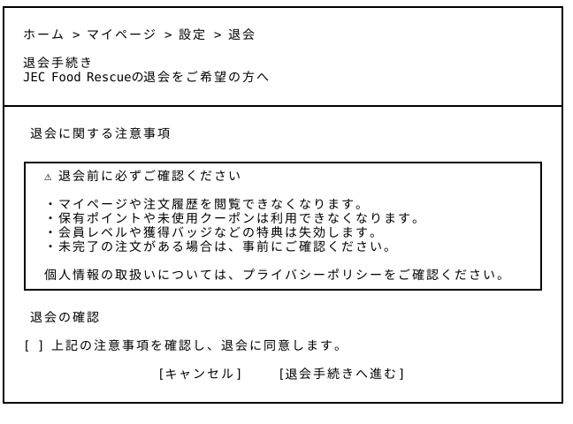
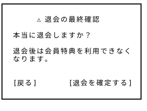

# 退会 — Wireframe v3

v2で未作成だった退会ページを新規追加し、設定ページからアクセスできる構成とした。

## 画面プレビュー





## 共通レイアウトとの役割分担

ヘッダー・フッター・通知／カート／アカウントのドロワーは[共通レイアウト v4](../../00_common/v4/README.md)を使用し、退会手続きはそのメインコンテンツ領域に配置する。図で共通部分が省略されていても、実装時は組み合わせて表示する。

本ページは[アカウント設定](../../21_account_setting/v4/README.md)から開く会員向けページとし、注意事項、同意、キャンセル、退会確定はページ側で管理する。最終確認は本ページ上のモーダルであり、共通アカウントドロワーとは別の表示とする。退会が完了した場合は共通側の認証状態にも反映し、ログイン済みの利用者情報を表示し続けない。

## 退会ページ全体

```
┌──────────────────────────────────────────────────────────────────────────────┐
│                                                                              │
│  ホーム > マイページ > 設定 > 退会                                             │
│                                                                              │
│  退会手続き                                                                   │
│  JEC Food Rescueの退会をご希望の方へ                                           │
│                                                                              │
├──────────────────────────────────────────────────────────────────────────────┤
│                                                                              │
│  ① 退会に関する注意事項                                                        │
│                                                                              │
│  ┌────────────────────────────────────────────────────────────────────────┐  │
│  │  ⚠ 退会前に必ずご確認ください                                            │  │
│  │                                                                        │  │
│  │  ・マイページや注文履歴を閲覧できなくなります。                            │  │
│  │  ・保有ポイントや未使用クーポンは利用できなくなります。                     │  │
│  │  ・会員レベルや獲得バッジなどの特典は失効します。                          │  │
│  │  ・未完了の注文がある場合は、事前にご確認ください。                        │  │
│  │                                                                        │  │
│  │  個人情報の取扱いについては、プライバシーポリシーをご確認ください。          │  │
│  └────────────────────────────────────────────────────────────────────────┘  │
│                                                                              │
│  ② 退会の確認                                                                 │
│                                                                              │
│  [ ] 上記の注意事項を確認し、退会に同意します。                                  │
│                                                                              │
│                     [キャンセル]     [退会手続きへ進む]                         │
│                                                                              │
└──────────────────────────────────────────────────────────────────────────────┘
```

## 最終確認（退会ページ上の確認モーダル）

退会に伴うポイント・クーポン・会員特典などへの影響を明示し、注意事項への同意と最終確認を設けることで、誤操作による退会を防止する。

```
┌──────────────────────────────────┐
│                                  │
│        ⚠ 退会の最終確認           │
│                                  │
│  本当に退会しますか？              │
│                                  │
│  退会後は会員特典を利用できなく     │
│  なります。                       │
│                                  │
│                                  │
│  [戻る]        [退会を確定する]    │
│                                  │
└──────────────────────────────────┘
```

※ 退会成功メッセージの表示ページ⇒今回は作りません