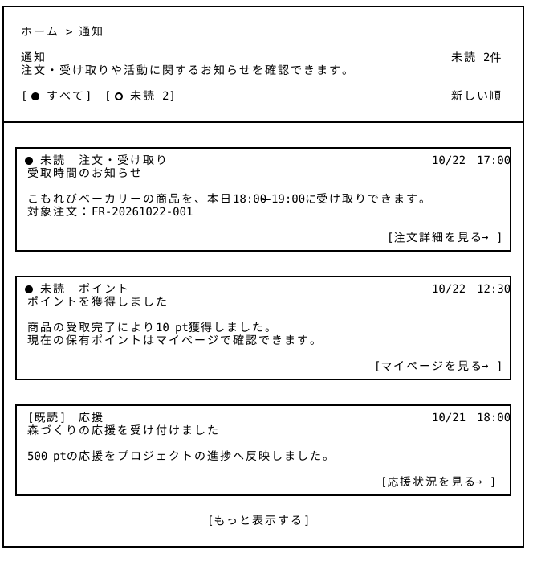

# 通知 — Wireframe v4

## 画面プレビュー



## 共通レイアウトとの役割分担

通知一覧は、ヘッダーの通知ドロワーから開く独立したページとして設計する。ヘッダー・フッターは[共通レイアウト](../../00_common/v4/README.md)側で管理し、本ページには通知一覧のメインコンテンツを記載する。

ドロワーでは最近の通知を確認し、本ページでは過去の通知を含めて閲覧する。どちらの表示からも、個別の通知を選択すると関連する既存画面へ進める。

## 1. 通知一覧ページ（ログイン済み）

```
┌────────────────────────────────────────────────────────────────────────────────┐
│                                                                                │
│  ホーム > 通知                                                                  │
│                                                                                │
│  通知                                                               未読 2件    │
│  注文・受け取りや活動に関するお知らせを確認できます。                               │
│                                                                                │
│  [● すべて]  [○ 未読 2]                                               新しい順   │
│                                                                                │
├────────────────────────────────────────────────────────────────────────────────┤
│                                                                                │
│ ┌────────────────────────────────────────────────────────────────────────────┐ │
│ │ ● 未読  注文・受け取り                                         10/22 17:00   │ │
│ │ 受取時間のお知らせ                                                           │ │
│ │                                                                            │ │
│ │ こもれびベーカリーの商品を、本日18:00–19:00に受け取りできます。                 │ │
│ │ 対象注文：FR-20261022-001                                                   │ │
│ │                                                                            │ │
│ │                                                         [注文詳細を見る →]  │ │
│ └────────────────────────────────────────────────────────────────────────────┘ │
│                                                                                │
│ ┌────────────────────────────────────────────────────────────────────────────┐ │
│ │ ● 未読  ポイント                                               10/22 12:30  │ │
│ │ ポイントを獲得しました                                                       │ │
│ │                                                                            │ │
│ │ 商品の受取完了により10 pt獲得しました。                                       │ │
│ │ 現在の保有ポイントはマイページで確認できます。                                 │ │
│ │                                                                            │ │
│ │                                                       [マイページを見る →]  │ │
│ └────────────────────────────────────────────────────────────────────────────┘ │
│                                                                                │
│ ┌────────────────────────────────────────────────────────────────────────────┐ │
│ │ [既読]  応援                                                   10/21 18:00  │ │
│ │ 森づくりの応援を受け付けました                                                │ │
│ │                                                                            │ │
│ │ 500 ptの応援をプロジェクトの進捗へ反映しました。                               │ │
│ │                                                                            │ │
│ │                                                        [応援状況を見る →]   │ │
│ └────────────────────────────────────────────────────────────────────────────┘ │
│                                                                                │
│                               [もっと表示する]                                  │
│                                                                                │
└────────────────────────────────────────────────────────────────────────────────┘
```

※ 日時・ポイント・件数・通知本文は表示例。●は未読を表し、既読の通知には「既読」と表示する。

| エリア | 機能・設計方針 |
|---|---|
| ページタイトル・未読件数 | 「通知」と現在の未読件数を表示する。件数は未読タブと通知ドロワーで共通とする。 |
| 表示切替 | 初期表示は「すべて」。未読タブでは未読通知のみを表示する。どちらも新しい順とする。 |
| 通知カード | 未読・既読、種類、日時、タイトル、本文、関連画面への入口を表示する。カードまたは入口を選択すると、その通知を既読にして関連画面へ進む。 |
| 追加表示 | 「もっと表示する」で、現在のタブの条件に合う過去の通知を同じ一覧へ追加する。未表示の通知がない場合はボタンを表示しない。 |

## 2. 通知の内容と遷移先

独立した通知詳細ページは設けず、通知本文をカード内に表示する。操作が必要な内容は、対象となる既存画面へ直接案内する。

| 通知の例 | カードの入口 | 遷移先 |
|---|---|---|
| 注文・受け取りに関する案内 | 注文詳細を見る | [注文履歴](../../11_order_history/v3/README.md)内の対象注文詳細。 |
| ポイント獲得の案内 | マイページを見る | [マイページ](../../06_mypage/v4/README.md)の保有ポイント欄。 |
| 森づくりへの応援受付 | 応援状況を見る | [マイページ](../../06_mypage/v4/README.md)の「みんなで応援する森づくり」欄。 |

## 3. 表示・操作仕様

- **ログイン状態**：個人宛ての通知はログイン済みの利用者に表示する。未ログインで本ページを開いた場合は、[ログイン](../../12_login/v4/README.md)に飛ばします。

- **ドロワーからの遷移**：共通レイアウトの「通知をすべて見る」から本ページを開き、通知ドロワーは閉じる。初期表示は「すべて」とする。

- **既読処理**：通知ドロワー・通知一覧を開く、タブを切り替える、一覧をスクロールする、「もっと表示する」を選択するだけでは既読にしない。個別の通知カードまたは関連画面へのリンクを選択したとき、その通知だけを既読にする。

- **状態の同期**：既読状態と未読件数は通知ドロワーと通知一覧で共有する。関連画面から戻った際は最新の状態を反映し、未読タブでは既読になった通知を一覧から除く。

- **一覧への復帰**：通知から関連画面へ進んだ後、ブラウザーの戻る操作で通知一覧へ戻った場合は、選択していたタブとスクロール位置を維持する。未読タブの既読項目は除き、必要に応じて表示位置を調整する。

### 空状態・取得失敗時の表示

| 状態 | 表示・操作 |
|---|---|
| 通知がない | 「通知はありません」と表示する。追加表示ボタンは表示しない。 |
| 未読通知がない | 未読タブの一覧領域に「未読の通知はありません」と表示し、「すべての通知を見る」で「すべて」タブへ切り替えられるようにする。 |
| 初回の取得失敗 | 一覧領域に「通知を読み込めませんでした」と「再読み込み」を表示する。未読件数は「—」とし、通知が0件の状態と区別する。 |
| 追加表示の取得失敗 | 取得済みの通知は残し、追加表示部分に失敗メッセージと再試行の入口を表示する。 |

## 4. v4の追加点と設計意図

- **通知ドロワーと一覧ページの役割分担**：閲覧中のページから最近の通知を素早く確認するドロワーに加え、過去の通知も確認できる完全版の一覧ページを追加した。

- **確認状態の明確化**：未読・既読と日時を各カードに表示し、「すべて」「未読」を切り替えられる構成とした。個別の通知を選択するまでは未読を維持し、未確認の情報を把握できるようにする。

- **必要な操作への直接誘導**：通知本文と関連画面への入口を同じカードに配置した。注文詳細やマイページの該当箇所へ直接進める構成とし、通知内容の確認から次の操作につなげる。
