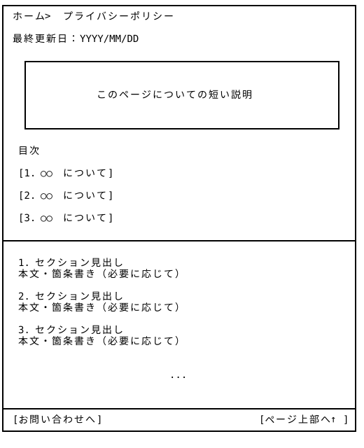

# プライバシーポリシー — Wireframe v4

## 画面プレビュー



## 1. プライバシーポリシー

```
┌──────────────────────────────────────────────────────────────┐
│ ホーム > プライバシーポリシー                                  │
│                                                              │
│ 最終更新日：YYYY/MM/DD                                        │
│                                                              │
│   ┌───────────────────────────────────────────────────────┐  |
|   |                                                       |  |
|   |                                                       |  |
|   |               このページについての短い説明               │  |
|   |                                                       |  |
|   |                                                       |  |
|   └───────────────────────────────────────────────────────┘  |
│                                                              │
│  目次                                                        │
│  [1. ○○について]                                              │
|  [2. ○○について]                                              │
│  [3. ○○について]                                              │
├──────────────────────────────────────────────────────────────┤
│  1. セクション見出し                                           │
│  本文・箇条書き（必要に応じて）                                 │
│                                                              │
│  2. セクション見出し                                           │
│  本文・箇条書き（必要に応じて）                                 │
│                                                              │
│                             ...                              │
├──────────────────────────────────────────────────────────────┤
│ [お問い合わせへ]                               [ページ上部へ ↑] │
└──────────────────────────────────────────────────────────────┘
```

## 2. 新規作成説明

v4で、これまで未作成だったプライバシーポリシーページを追加しました。

- 本文は初期状態ですべて表示されており、連続して読み進められます。
  
- ページ上部の目次をクリックすると、該当セクションへページ内ジャンプします。

### 本文の構成（暫定）

1. 取得する情報と利用目的

    |情報の種類|利用目的|
    |---|---|
    |ニックネーム・メールアドレス等|会員登録、ログイン、アカウント管理、通知の送信|
    |注文・受取履歴	|注文処理、履歴の表示、ポイントの計算|
    |位置情報|近くの商品・店舗の検索、距離の表示(取得のタイミング、保存の有無などユーザーが最も気にする点)|
    |レビュー・通報内容|レビューの公開、不適切な内容の確認と管理|
    |ポイント・ゲーム・植樹記録|ポイント残高、ゲームの進行状況、わたしの森および実績の表示|
    |お問い合わせ内容|お問い合わせへの回答、関連状況の調査|

2. 公開される情報

    レビューに表示されるニックネーム、評価、本文など、他のユーザーに公開される情報を記載

3. 外部サービスの利用

    実際に利用しているクラウドサービス、メール配信サービス、地図APIなどと、それぞれに提供される情報を記載

4. 情報の保管・退会後の取扱い

    実際の保存方法、および退会時の削除方法に基づいて記載

5. 情報に関するお問い合わせ

    情報の訂正・削除などに関する問い合わせを記載

6. ポリシーの変更

    改定日、および変更時の通知方法を記載