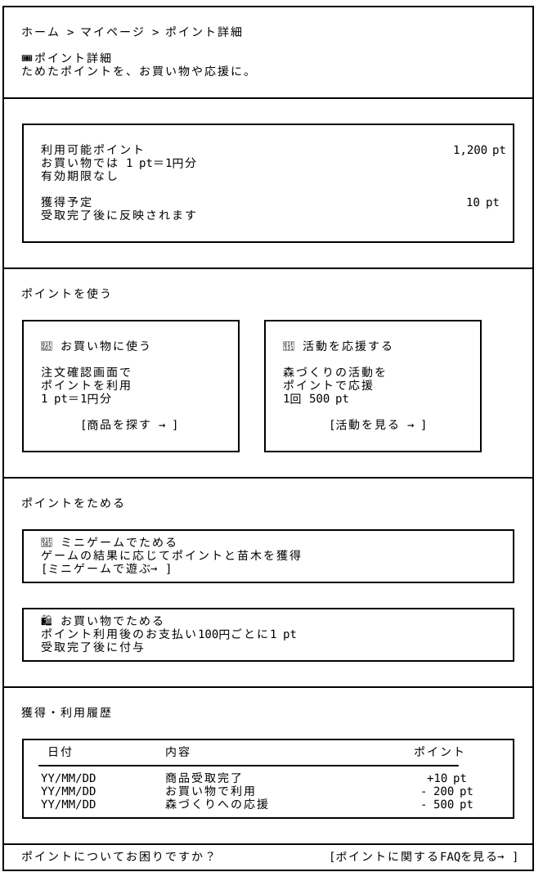

# ポイント詳細 — Wireframe v4

## 画面プレビュー



## 1. ポイント詳細

```
┌────────────────────────────────────────────────────────────────────────────────┐
│                                                                                │
│  ホーム > マイページ > ポイント詳細                                              │
│                                                                                │
│  🎟 ポイント詳細                                                                │
│  ためたポイントを、お買い物や応援に。                                             │
│                                                                                │
├────────────────────────────────────────────────────────────────────────────────┤
│                                                                                │
│  ┌──────────────────────────────────────────────────────────────────────────┐  │
│  │                                                                          │  │
│  │  利用可能ポイント                                               1,200 pt  │  │
│  │  お買い物では 1 pt＝1円分                                                 │  │
│  │  有効期限なし                                                            │  │
│  │                                                                          │  │
│  │  獲得予定                                                      10 pt      │  │
│  │  受取完了後に反映されます                                                  │  │
│  │                                                                          │  │
│  └──────────────────────────────────────────────────────────────────────────┘  │
│                                                                                │
├────────────────────────────────────────────────────────────────────────────────┤
│                                                                                │
│  ポイントを使う                                                                 │
│                                                                                │
│  ┌────────────────────────────────┐   ┌────────────────────────────────┐       │
│  │                                │   │                                │       │
│  │  🛒 お買い物に使う              │   │  🌱 活動を応援する              │       │
│  │                                │   │                                │       │
│  │  注文確認画面で                 │   │  森づくりの活動を                │       │
│  │  ポイントを利用                 │   │  ポイントで応援                  │       │
│  │  1 pt＝1円分                    │   │  1回 500 pt                    │       │
│  │                                │   │                                │       │
│  │         [商品を探す →]          │   │          [活動を見る →]         │       │
│  │                                │   │                                │       │
│  └────────────────────────────────┘   └────────────────────────────────┘       │
│                                                                                │
├────────────────────────────────────────────────────────────────────────────────┤
│                                                                                │
│  ポイントをためる                                                               │
│                                                                                │
│  ┌──────────────────────────────────────────────────────────────────────────┐  │
│  │  🎲 ミニゲームでためる                                                    │  │
│  │  ゲームの結果に応じてポイントと苗木を獲得                                   │  │
│  │  [ミニゲームで遊ぶ →]                                                     │  │
│  └──────────────────────────────────────────────────────────────────────────┘  │
│                                                                                │
│  ┌──────────────────────────────────────────────────────────────────────────┐  │
│  │  🛍 お買い物でためる                                                       │  │
│  │  ポイント利用後のお支払い100円ごとに1 pt                                    │  │
│  │  受取完了後に付与                                                          │  │
│  └──────────────────────────────────────────────────────────────────────────┘  │
│                                                                                │
├────────────────────────────────────────────────────────────────────────────────┤
│                                                                                │
│  獲得・利用履歴                                                                 │
│                                                                                │
│  ┌──────────────────────────────────────────────────────────────────────────┐  │
│  │   日付         内容                                     ポイント          │  │
│  │  ────────────────────────────────────────────────────────────────        │  │
│  │  ○/○         商品受取完了                               +10 pt            │  │
│  │  ○/○         お買い物で利用                             -200 pt           │  │
│  │  ○/○         森づくりへの応援                           -500 pt           │  │
│  └──────────────────────────────────────────────────────────────────────────┘  │
│                                                                                │
├────────────────────────────────────────────────────────────────────────────────┤
│  ポイントについてお困りですか？                      [ポイントに関するFAQを見る →]  │
└────────────────────────────────────────────────────────────────────────────────┘
```

## 2. 追加設計の内容と意図

ポイントの保有状況、獲得方法、利用方法、履歴を一つの画面に集約し、ポイントの仕組みを分かりやすく確認できる「ポイント詳細」ページを追加した。

### 主な操作と画面遷移

| 操作・ボタン | 遷移先・動作 |
|---|---|
| ホーム > マイページ > ポイント詳細 | パンくずリストからホーム・マイページへ戻れる。 |
| [商品を探す →] | 「商品一覧」ページへ遷移する。注文確認画面でポイントを利用できる。 |
| [活動を見る →] | 「マイページ」内の「みんなで応援する森づくり」エリアへ移動する。 |
| [ミニゲームで遊ぶ →] | 既存のミニゲーム用モーダルを表示する。独立したページは設けない。 |
| [ポイントに関するFAQを見る →] | 「FAQ・ご利用ガイド」のポイント関連項目へ移動する。 |

### 表示・更新に関する仕様

- **利用可能ポイント**：現在の残高を表示し、ポイントの獲得・利用に応じて更新する。有効期限は設けないが退会時は保有ポイントが失効する。
- **獲得予定ポイント**：注文済み・受取待ちの商品から獲得予定のポイントを表示する。受取完了後に保有残高へ反映する。
- **獲得・利用履歴**：ポイントの増減を日付・内容・数量とともに表示する。独立した履歴詳細ページは設けない。
- **ポイント付与ルール**：購入時にポイントを利用した場合、割引後の実際の支払金額100円ごとに1 ptを付与する（100円未満切り捨て）。

### 画面数を増やさないための方針

ポイント利用に関する各操作は、既存の「商品一覧」「注文確認」「マイページ」「FAQ」およびミニゲーム用モーダルに接続する。新たな活動詳細ページや専用の履歴ページは作成せず、既存画面への遷移とページ内表示を活用することで、機能の重複と実装工数を抑える。
