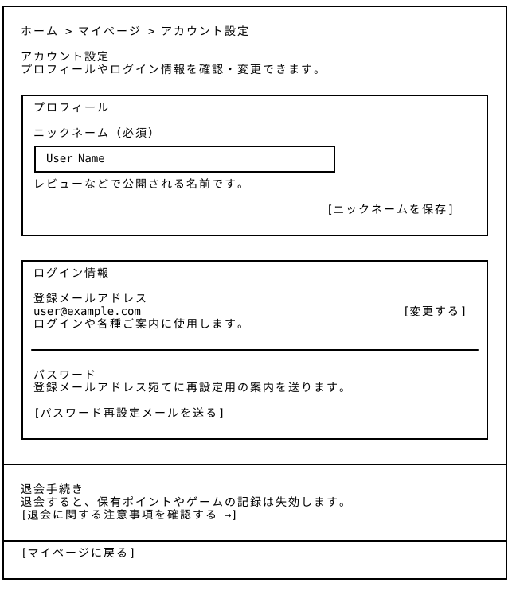
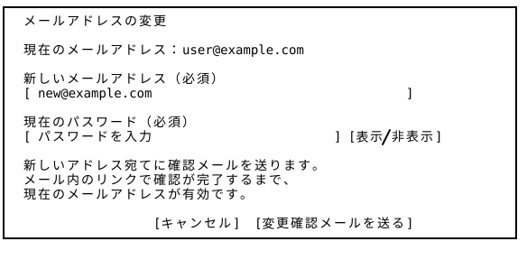

# アカウント設定 — Wireframe v4

## 画面プレビュー





## 共通レイアウトとの役割分担

[マイページ](../../06_mypage/v4/README.md)の「設定」、または[アカウントドロワー](../../00_common/v4/README.md)の「設定」から開く、ログイン済み利用者向けのページとする。ヘッダー・フッターは共通レイアウト側で管理し、本ページではメインコンテンツと編集状態を設計する。

登録情報は[新規登録](../../13_signup/v3/README.md)に合わせ、ニックネーム・メールアドレス・パスワードを扱う。マイページは活動やゲームの成果を確認する場所、本ページは登録情報を管理する場所として役割を分ける。

## 1. アカウント設定（初期表示）

```
┌──────────────────────────────────────────────────────────────────────────────┐
│                                                                              │
│  ホーム > マイページ > アカウント設定                                           │
│                                                                              │
│  アカウント設定                                                               │
│  プロフィールやログイン情報を確認・変更できます。                                │
│                                                                              │
│  ┌────────────────────────────────────────────────────────────────────────┐  │
│  │ プロフィール                                                            │  │
│  │                                                                        │  │
│  │ ニックネーム（必須）                                                     │  │
│  │ ┌──────────────────────────────────────────────┐                       │  │
│  │ │ User Name                                    │                       │  │
│  │ └──────────────────────────────────────────────┘                       │  │
│  │ レビューなどで公開される名前です。                                        │  │
│  │                                                                        │  │
│  │                                               [ニックネームを保存]       │  │
│  │                                                                        │  │
│  └────────────────────────────────────────────────────────────────────────┘  │
│                                                                              │
│  ┌────────────────────────────────────────────────────────────────────────┐  │
│  │ ログイン情報                                                            │  │
│  │                                                                        │  │
│  │ 登録メールアドレス                                                      │  │
│  │ user@example.com                                          [変更する]   │  │
│  │ ログインや各種ご案内に使用します。                                        │  │
│  │                                                                        │  │
│  │ ────────────────────────────────────────────────────────────────────── │  │
│  │                                                                        │  │
│  │ パスワード                                                              │  │
│  │ 登録メールアドレス宛てに再設定用の案内を送ります。                          │  │
│  │                                                                        │  │
│  │ [パスワード再設定メールを送る]                                            │  │
│  │                                                                        │  │
│  └────────────────────────────────────────────────────────────────────────┘  │
│                                                                              │
├──────────────────────────────────────────────────────────────────────────────┤
│                                                                              │
│  退会手続き                                                                   │
│  退会すると、保有ポイントやゲームの記録は失効します。                             │
│  [退会に関する注意事項を確認する →]                                             │
│                                                                              │
├──────────────────────────────────────────────────────────────────────────────┤
│  [マイページに戻る]                                                           │
└──────────────────────────────────────────────────────────────────────────────┘
```

※ ニックネーム・メールアドレスは表示例。ニックネーム欄には保存済みの値を表示する。「ニックネームを保存」は、値を変更するまで無効とする。

| エリア | 内容・操作 |
|---|---|
| プロフィール | 公開されるニックネームを編集し、この項目だけを保存する。公開範囲の説明を入力欄の近くに表示する。 |
| 登録メールアドレス | 現在の登録アドレスと用途を表示する。「変更する」で、同じカード内に変更フォームを展開する。 |
| パスワード | 登録メールアドレス宛てに再設定用の案内を送る。送信後は、本ページ内に送信結果を表示する。 |
| 退会手続き | 通常の編集操作から離してページ下部に配置する。注意事項への入口から既存の[退会ページ](../../14_withdrawal/v3/README.md)へ進む。 |

## 2. メールアドレス変更（ログイン情報カード内）

「変更する」を選ぶと、登録メールアドレス欄を以下のフォームに切り替える。プロフィール欄とパスワード再設定の案内はそのまま表示する。

```
┌──────────────────────────────────────────────────────────────────────┐
│  メールアドレスの変更                                                  │
│                                                                      │
│  現在のメールアドレス：user@example.com                                │
│                                                                      │
│  新しいメールアドレス（必須）                                           │
│  [ new@example.com                                    ]              │
│                                                                      │
│  現在のパスワード（必須）                                              │
│  [ パスワードを入力                         ] [表示/非表示]            │
│                                                                      │
│  新しいアドレス宛てに確認メールを送ります。                              │
│  メール内のリンクで確認が完了するまで、                                  │
│  現在のメールアドレスが有効です。                                       │
│                                                                      │
│                    [キャンセル]  [変更確認メールを送る]                 │
└──────────────────────────────────────────────────────────────────────┘
```

### 変更の流れ

1. 新しいメールアドレスと現在のパスワードを入力し、「変更確認メールを送る」を選択する。
   
2. 入力内容と本人確認が有効な場合、新しいアドレス宛てに確認メールを送る。送信時点では登録アドレスを変更しない。
   
3. フォームを送信済み表示に切り替え、「new@example.com に確認メールを送りました。メール内のリンクを開いて変更を完了してください。」と表示する。「確認メールを再送する」「入力し直す」を案内する。
   
4. メール内のリンクから確認を完了すると登録アドレスを変更し、本ページに「メールアドレスを変更しました。」と表示する。登録メールアドレス欄も新しい値へ更新する。以後のログイン・案内メール・パスワード再設定には新しいアドレスを使用する。

### 表示・操作仕様

- **必須入力**：新しいメールアドレスと現在のパスワードを必須とする。形式が正しくないアドレス、現在と同じアドレス、登録に使用できないアドレスの場合は、該当欄にエラーを表示する。
- **本人確認**：現在のパスワードが一致しない場合は確認メールを送信しない。パスワード欄は初期状態で非表示とし、表示・非表示を切り替えられるようにする。
- **送信前のキャンセル**：「キャンセル」で入力内容を破棄し、現在の登録メールアドレスの表示へ戻す。他の項目の保存済み情報は変更しない。
- **送信後の修正・再送**：「入力し直す」で変更フォームに戻る。再送・再申請した場合は最新の確認リンクだけを有効とし、送信済み表示には最新の宛先を示す。パスワードの入力値は送信後・キャンセル後に消去する。
- **確認リンク**：リンクが期限切れ・使用済み・無効の場合は「この確認リンクは利用できません。アカウント設定から、もう一度お手続きください。」と表示し、本ページへの入口を案内する。確認リンクの有効期間は登録確認メールの仕様と統一する。
- **確認時のログイン**：変更対象の本人としてログインした状態で確認を完了する。未ログインの場合はログイン後に確認処理へ戻す。確認が完了するまでは現在の登録アドレスでログインする。

## 3. パスワードの再設定

[ログインv4のパスワード再設定](../../12_login/v4/README.md)を利用する。本ページでは登録済みアドレスを送信先として使用し、メールアドレスの再入力を省く。

| 段階 | 表示・操作 |
|---|---|
| 送信前 | 現在の登録メールアドレスを確認できる位置に「パスワード再設定メールを送る」を配置する。 |
| 送信中 | ボタンを「送信中…」に変更して無効にし、重複送信を防ぐ。 |
| 送信成功 | パスワード欄に「user@example.com に再設定用の案内を送りました。メールをご確認ください。」と「再送する」を表示する。 |
| メールからの操作 | 既存の「新しいパスワードの設定」へ進む。12文字以上・確認用入力・表示/非表示の仕様はログインv4と統一する。 |
| 設定完了 | 既存の「設定完了」画面からログインへ進み、新しいパスワードで利用を再開する。 |
| 送信失敗 | 「再設定メールを送信できませんでした。時間をおいて再度お試しください。」と表示し、再試行できるようにする。 |

メールアドレスの変更確認待ちでも、パスワード再設定の送信先は現在の登録アドレスとする。確認待ちの新しいアドレスには送信しない。

## 4. 共通の表示・操作仕様

- **ログイン状態と入口**：未ログインで開いた場合は[ログイン](../../12_login/v4/README.md)へ進み、ログイン後に本ページへ戻る。アカウントドロワーから遷移した場合はドロワーを閉じる。
- **ニックネームの保存**：必須項目とし、空欄・空白のみの場合は保存できない。文字数などの条件は新規登録と共通にする。保存成功後は「ニックネームを保存しました。」と表示し、マイページ・アカウントドロワー・レビューの公開名にも反映する。
- **項目ごとの処理**：ニックネームの保存、メールアドレスの変更確認、パスワード再設定メールの送信はそれぞれ独立した操作とする。他の欄に未保存の入力があっても、まとめて保存・破棄しない。
- **送信中の表示**：処理中のボタンは無効にし、「保存中…」「送信中…」と表示する。完了後に結果を表示し、再び操作できる状態へ戻す。
- **未保存の入力**：未保存のニックネームや送信前の変更フォームがある状態でページを離れる場合は、「変更内容は保存されていません。」と案内し、「編集を続ける」「保存せずに移動」を選べるようにする。ブラウザーを閉じる場合などは標準の離脱確認を利用する。
- **退会への遷移**：本ページでは退会を確定せず、既存の退会ページで注意事項の確認・同意・最終確認を行う。退会によるポイント・ゲーム記録の失効と、個人情報の取り扱いは[利用規約](../../17_terms/v4/README.md)・[プライバシーポリシー](../../18_privacy/v4/README.md)とそろえる。
- **狭い画面**：各カードを縦に配置し、長いメールアドレスは折り返す。入力欄と操作ボタンは画面幅に収め、横スクロールを発生させない。

### 入力エラー・取得失敗時の表示

| 状態 | 表示・操作 |
|---|---|
| ニックネーム未入力 | 入力欄の直下に「ニックネームを入力してください。」と表示する。 |
| メールアドレスの形式が不正 | 入力欄の直下に「メールアドレスの形式を確認してください。」と表示する。 |
| 現在と同じメールアドレス | 「現在と異なるメールアドレスを入力してください。」と表示する。 |
| 登録に使用できないメールアドレス | 「このメールアドレスは使用できません。別のアドレスを入力してください。」と表示する。 |
| 現在のパスワードが不一致 | パスワード欄の直下に「現在のパスワードを確認してください。」と表示する。 |
| 登録情報の取得失敗 | 「アカウント情報を読み込めませんでした。」と「再読み込み」を表示する。空の登録情報として扱わず、変更操作を無効にする。 |
| ニックネームの保存失敗 | 「保存できませんでした。再度お試しください。」と表示する。入力したニックネームは残し、保存済みの値は変更しない。 |
| メール変更確認の送信失敗 | 「確認メールを送信できませんでした。再度お試しください。」と表示する。新しいアドレスの入力は残し、現在のパスワードは再入力する。 |
| 操作中にログインの有効期限が切れた | 「もう一度ログインしてください。」と案内する。ログイン後は本ページへ戻り、登録済みの情報を再取得する。パスワードを引き継がない。 |

## 5. v4の追加点と設計意図

- **登録情報の管理を集約**：登録時の情報を基準に、ニックネーム・メールアドレス・パスワードの操作を一つのページにまとめた。活動の成果を表示するマイページから、登録情報の編集へ進める構成とした。
- **公開名とログイン情報を分ける**：ニックネームは公開されることを説明し、メールアドレスはログインと案内に使うことを明示した。
- **変更の完了時点を明確化**：ニックネームは保存時、メールアドレスは確認リンクでの確認完了時に反映する。送信しただけで変更済みと受け取られない表示にする。
- **既存フローとの接続**：パスワード再設定と退会は、作成済みの画面へつなぐ。各操作の結果と復帰先を本ページでも定義した。
