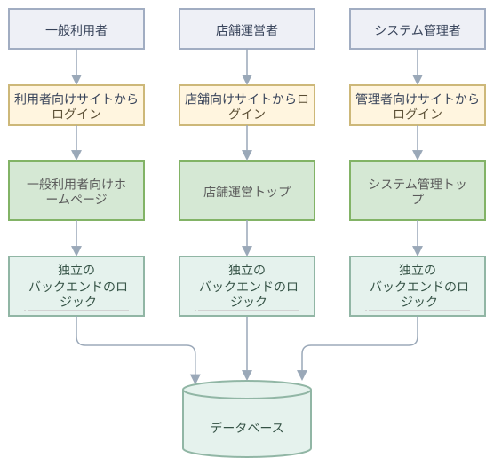
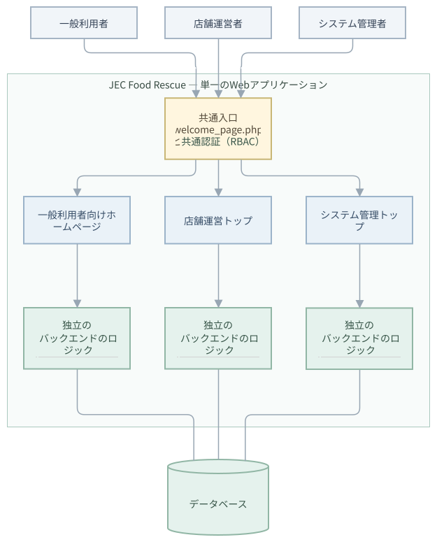

# 共通入口とログインの方針

従来は3つの役割ごとに別々の入口を想定していたが、討議の結果、共通入口に統一する方針とした。

## 変更前

  
## 変更後

単一のWebアプリケーションと共通データベースを使用する。ログイン後の行き先はアカウントの役割（account_type）で決まる。役割ごとのバックエンド処理と共通の業務処理を設けます。

## 画面遷移の流れ

1. `welcome_page.php` に3つのアバターを配置し、利用者が入口を選ぶ。
2. **一般利用者**：既存のホームページへ進む。未ログインでも商品を閲覧でき、ログインはドロワーメニューから行う。
3. **店舗運営者**：新しい画面で新規出店または既存アカウントでのログインを選ぶ。
4. **システム管理者**：ログイン画面へ進む。
5. ログイン画面は共通の `login.php` を使用する。ログイン後の行き先はアカウントの役割（account_type）で決まって、一般利用者はホームページ、店舗運営者は店舗管理トップ、システム管理者は管理トップへ飛ばします。
